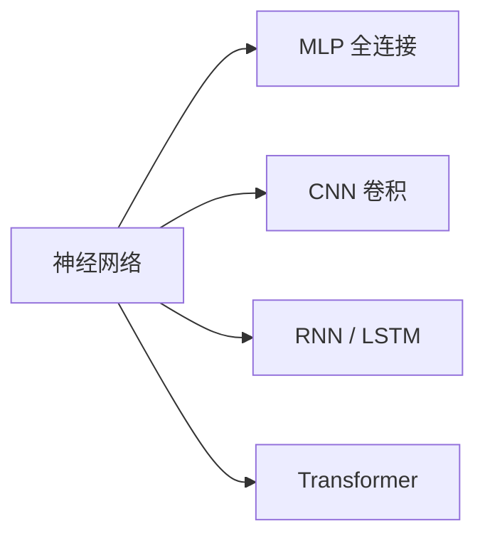

# 深度学习

深度学习用**多层神经网络**自动学习特征表示，是现代 AI 的基石。"深度"指隐藏层数量多：与传统机器学习不同，它把"特征工程"也交给了模型，原始数据经过层层非线性变换，逐层抽象出从边缘、纹理到语义的高级特征。

## 神经元与多层感知机

一个神经元完成"线性变换 + 非线性激活"：

$$
a = \sigma(Wx + b)
$$

激活函数引入非线性——没有它，多层网络会退化为一次线性变换。常见的激活函数对比：

| 激活函数 | 公式 | 特点 |
| -------- | ---- | ---- |
| Sigmoid | $\frac{1}{1+e^{-x}}$ | 输出 (0,1)，易梯度消失 |
| ReLU | $\max(0, x)$ | 简单高效，默认首选 |
| GELU | 平滑版 ReLU | Transformer 标配 |

把神经元按层组织，就得到多层感知机（MLP）：


（784 → 128 → 10 正是 MNIST 手写数字分类的经典配置。）

分类任务的输出层用 Softmax 把分数归一化为概率分布：

$$
\mathrm{softmax}(z)_i = \frac{e^{z_i}}{\sum_{j} e^{z_j}}
$$

## 训练三要素

1. **前向传播**：逐层计算输出，形状上就是一串矩阵乘法；
2. **损失计算**：衡量预测与真值的差距（MSE、交叉熵等）；
3. **反向传播**：链式法则求梯度，优化器（SGD / Adam）更新参数。

反向传播的核心是链式法则——复合函数的梯度沿计算图逐层相乘：

$$
\frac{\partial L}{\partial W_1} = \frac{\partial L}{\partial a_3} \cdot \frac{\partial a_3}{\partial a_2} \cdot \frac{\partial a_2}{\partial a_1} \cdot \frac{\partial a_1}{\partial W_1}
$$

### 常用损失函数

$$
L_{\mathrm{MSE}} = \frac{1}{n}\sum_{i} \left(y_i - \hat{y}_i\right)^2, \qquad
L_{\mathrm{CE}} = -\sum_{i} y_i \log \hat{y}_i
$$

- MSE 用于回归；交叉熵配合 Softmax 用于分类，梯度形式简洁、收敛快；
- PyTorch 的 `CrossEntropyLoss` 内部已包含 LogSoftmax，输入应传 logits 而非概率。
- 多分类交叉熵等价于最大似然估计：最小化 CE 就是最大化对数似然。

### 用 NumPy 手写前向传播

```python
import numpy as np

def forward(X, W1, b1, W2, b2):
    h = np.maximum(0, X @ W1 + b1)   # 隐藏层：线性变换 + ReLU
    return h @ W2 + b2               # 输出 logits
```

一个最小可用的 PyTorch 训练循环：

```python
import torch

model = torch.nn.Sequential(
    torch.nn.Linear(784, 128), torch.nn.ReLU(),
    torch.nn.Linear(128, 10),
)
optim = torch.optim.Adam(model.parameters(), lr=1e-3)
loss_fn = torch.nn.CrossEntropyLoss()

# 伪训练循环
for x, y in dataloader:
    optim.zero_grad()                  # 清空上一轮梯度
    loss = loss_fn(model(x.flatten(1)), y)
    loss.backward()      # 反向传播
    optim.step()         # 参数更新
```

!!! note "为什么按 mini-batch 训练"

    显存装不下全量数据；mini-batch 既降低内存占用，又让梯度带一点噪声，反而有助于跳出尖锐的极小值。

### 优化器对比

| 优化器 | 一句话概括 | 适用场景 |
| ------ | ---------- | -------- |
| SGD | 沿负梯度走，简单可控 | 大规模任务 + 精细调参 |
| Momentum | 累积历史梯度，冲过小坑 | 加速收敛 |
| Adam / AdamW | 自适应学习率 | 大多数任务的默认之选 |

AdamW 与 Adam 的区别在于权重衰减的实现方式（解耦），Transformer 类模型通常选 AdamW。

## 网络结构谱系



- **MLP**：全连接，通用近似；
- **CNN**：局部感受野 + 权值共享，参数量远小于同规模 MLP，适合图像；卷积层提取特征，池化层降低分辨率；
- **RNN / LSTM**：序列建模，逐步递推；LSTM 用门控机制缓解长程依赖的梯度消失；
- **Transformer**：自注意力，全局建模，见 [Transformer](../../llm/development/transformer.md)。其核心公式：

$$
\mathrm{Attention}(Q, K, V) = \mathrm{softmax}\!\left(\frac{QK^\top}{\sqrt{d_k}}\right)V
$$

## 训练稳定性与泛化

深度网络训练中常见的两大问题是**梯度消失 / 爆炸**与**过拟合**，常用对策：

| 问题 | 常用对策 |
| ---- | -------- |
| 梯度消失 | ReLU 系激活、残差连接、BatchNorm |
| 过拟合 | Dropout、权重衰减、数据增强、早停 |
| 训练不稳定 | 合理初始化、学习率预热与衰减、梯度裁剪 |

- **BatchNorm**：对每个 mini-batch 内的特征做标准化，稳定各层输入分布、加速收敛；
- **Dropout**：训练时随机置零部分神经元，相当于训练多个子网络的隐式集成；
- 学习率随训练进程衰减是标配：

```python
sched = torch.optim.lr_scheduler.CosineAnnealingLR(optim, T_max=100)
# 每个 epoch 结束后调用 sched.step()
```

!!! tip "学习路径建议"

    先手动实现一遍反向传播，再用 PyTorch 复现 MNIST 分类，最后读经典论文（ResNet、Attention Is All You Need）。

## 实践要点

1. 新任务先跑通最小流程（小模型 + 小数据），再逐步加复杂度；
2. 训练不收敛先查三件事：数据与标签、学习率、损失函数与输出层的匹配（`CrossEntropyLoss` 对应 logits）；
3. 同时监控训练 / 验证两条损失曲线，判断过拟合还是欠拟合，再对症下药；
4. BatchNorm 与 Dropout 在训练与推理时行为不同，部署前记得调用 `model.eval()`；
5. 复现结果要固定随机种子（如 `torch.manual_seed`），并记录硬件与版本信息。
6. 生成式任务看困惑度（PPL），检索任务看 Recall@K，不要只盯单一指标。
