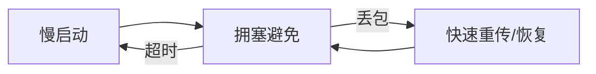
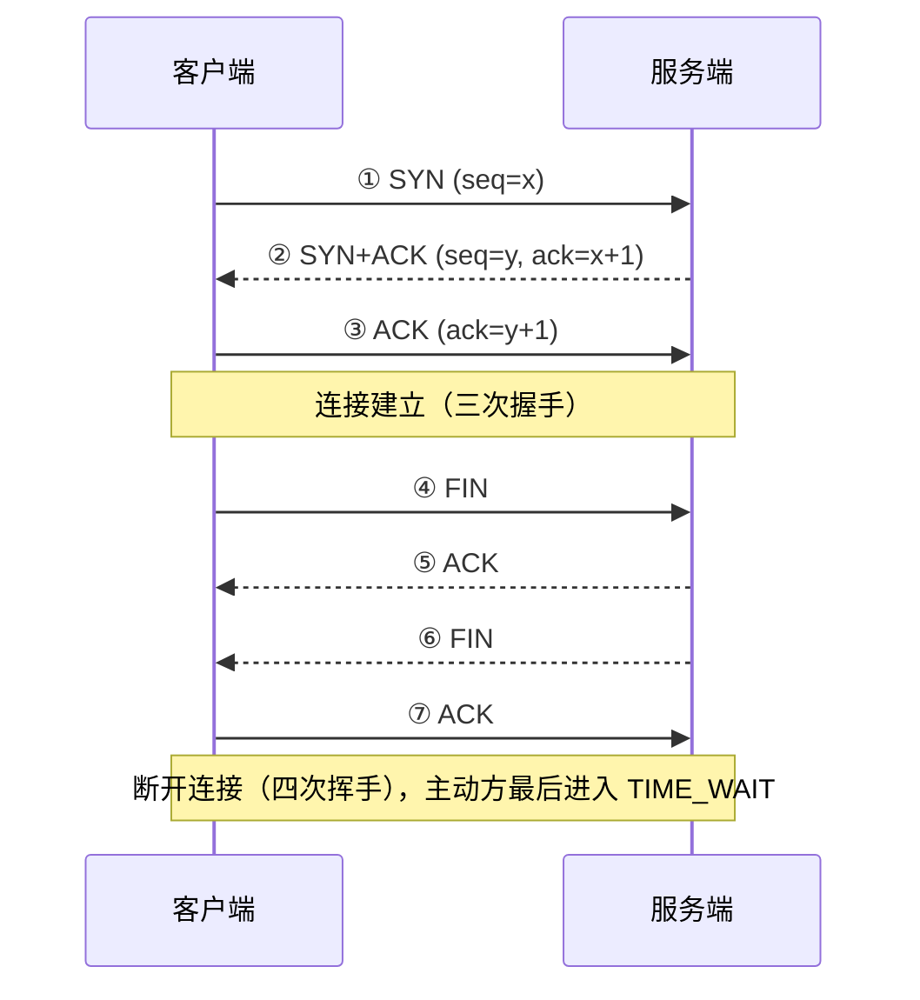

# 计算机网络

本页按 TCP/IP 分层模型自底向上梳理计算机网络的核心知识。网络是分布式系统的地基：无论是排查线上故障，还是设计高并发服务，都建立在对分层的理解之上。

## 分层模型

| 层次 | 核心问题 | 关键协议/设备 |
| ---- | -------- | -------------- |
| 应用层 | 数据如何表示与交互 | HTTP、DNS、SMTP |
| 传输层 | 进程间可靠通信 | TCP、UDP |
| 网络层 | 主机间路由转发 | IP、ICMP、路由器 |
| 数据链路层 | 相邻节点帧传输 | 以太网、交换机、ARP |
| 物理层 | 比特流传输 | 网线、光纤、集线器 |

OSI 七层模型把会话层、表示层从应用层中拆出，教学中常用；工程实践以 TCP/IP 分层为准。

发送方数据自上而下逐层**封装**（每层加上自己的头部），接收方自下而上逐层**解封装**；同层协议在逻辑上直接对话，实际数据都要经过下方各层转发。

## 网络层：IP 与路由

IPv4 地址 32 位，CIDR 记法如 `192.168.1.0/24` 表示前 24 位是网络号；**NAT** 让多台内网机器共享一个公网 IP 出网，是 IPv4 地址紧张的主流缓解手段。

路由器按**最长前缀匹配**查路由表转发数据包；`ICMP` 承载差错与探测报文，`ping` 与 `traceroute` 都构建在它之上。

IPv6 用 128 位地址从根本上缓解地址不足，与 IPv4 长期共存。

## 传输层：TCP 与 UDP

| 维度 | TCP | UDP |
| ---- | --- | --- |
| 连接 | 面向连接（握手 / 挥手） | 无连接 |
| 可靠性 | 可靠、有序、不丢不重 | 尽最大努力交付 |
| 传输单位 | 字节流 | 数据报 |
| 典型场景 | 网页、文件传输、数据库 | 视频、DNS、游戏 |

## TCP 的三个灵魂问题

### 可靠传输

序列号 + 确认应答 + 超时重传 + 滑动窗口。丢包判定依赖**快速重传**（收到 3 个重复 ACK）与超时定时器。

确认应答采用累积确认；发送方维护"已发送未确认"的滑动窗口，窗口内的字节可以连续发出。

### 流量控制

接收方通过 TCP 头部中的窗口字段通告剩余缓冲区大小，防止发送方压垮接收方；发送方未获确认的数据量不能超过该窗口。

### 拥塞控制



流量控制保护"接收方"，拥塞控制保护"网络"：发送方维护拥塞窗口，慢启动阶段指数增长，达到阈值后线性增加（拥塞避免）。

### 建立与断开



TIME_WAIT 让主动关闭方停留约 2 个报文生存期（2MSL），确保最后一个 ACK 可达、旧报文自然消亡——这也是高并发短连接下出现大量 TIME_WAIT 的原因。

!!! tip "高频面试点"

    - 为什么握手三次而挥手四次？（半关闭状态）
    - TCP 粘包怎么解决？（定长 / 分隔符 / 长度前缀）
    - HTTP 1.1 / 2 / 3 的区别？（队头阻塞 → 多路复用 → QUIC）

## 应用层：DNS 与 HTTP

### DNS：域名如何变成 IP

解析自上而下逐级查询：浏览器缓存 → 系统缓存 → 本地域名服务器（递归查询）→ 根域名服务器 → 顶级域服务器 → 权威服务器（迭代查询），最终拿到 IP 并缓存。

常见记录类型：A（IPv4）、AAAA（IPv6）、CNAME（别名）、MX（邮件）。

传输层上，DNS 常规查询走 UDP 53，区域传送与大报文回退到 TCP 53。

### HTTP 报文与状态码

请求报文由"请求行 + 头部 + 空行 + 主体"组成：

```http
GET /index.html HTTP/1.1
Host: example.com
User-Agent: wiki-demo
Accept: text/html
```

| 状态码 | 含义 |
| ------ | ---- |
| 200 | 成功 |
| 301 / 302 | 永久 / 临时重定向 |
| 403 / 404 | 禁止访问 / 资源不存在 |
| 500 / 502 / 504 | 服务端错误 / 网关错误 / 网关超时 |

### HTTP 版本演进

| 版本 | 关键改进 |
| ---- | -------- |
| 1.1 | 长连接、管线化（队头阻塞仍在） |
| 2 | 二进制分帧、多路复用、头部压缩 |
| 3 | 基于 QUIC（UDP），彻底解决 TCP 层队头阻塞 |

### HTTPS 与无状态

HTTPS = HTTP + TLS：握手阶段用**非对称加密**交换密钥并验证证书链，之后用**对称加密**传输数据，兼顾安全与性能。

HTTP 是无状态协议，登录态靠 Cookie 携带：服务端发 `Set-Cookie`，浏览器后续请求自动带上。Session 把状态存服务端，JWT 把状态签名后放客户端，是无状态的两种补救方案；需要服务器主动推送的场景（聊天、行情）则用 WebSocket，基于 HTTP 握手后升级为全双工长连接。

## 一次完整的 HTTP 请求

1. DNS 解析域名 → 得到 IP；
2. TCP 三次握手建立连接（SYN → SYN+ACK → ACK）；
3. TLS 握手协商密钥（HTTPS）；
4. 发送 HTTP 请求报文，服务端返回响应；
5. 四次挥手释放连接。

## 常用排查命令

```bash
ping example.com             # 连通性与延迟
traceroute example.com       # 路径追踪
dig example.com              # DNS 解析详情
curl -v https://example.com  # 报文级调试
tcpdump -i any port 443      # 抓包分析
ss -tlnp                     # 本地端口监听
```

## 实践要点

1. 排查问题自底向上：先 `ping` 查连通性，再查端口（`ss` / `telnet`），最后看应用层报文（`curl -v`）；
2. 服务监听 `0.0.0.0` 才能被外部访问，`127.0.0.1` 仅本机可达；
3. 对外 API 必上 HTTPS，注意证书有效期与自动续期；
4. 高并发短连接场景关注 TIME_WAIT 堆积，用连接池或长连接复用缓解；
5. 性能优化先看"距离与次数"：CDN 靠近用户、连接复用减少握手、批量合并请求。
6. 出问题先分清网络还是应用：连接数与 socket 状态用 `ss`，错误率看应用日志，交互时序抓包分析。
