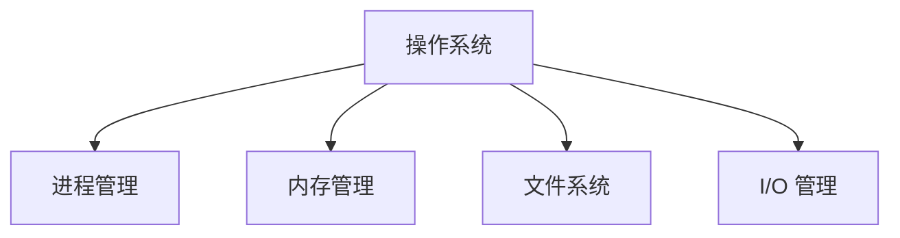
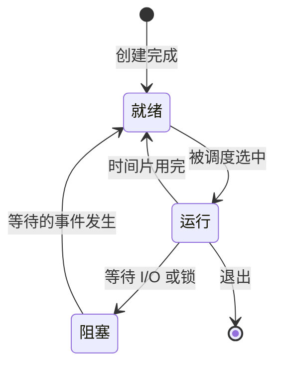
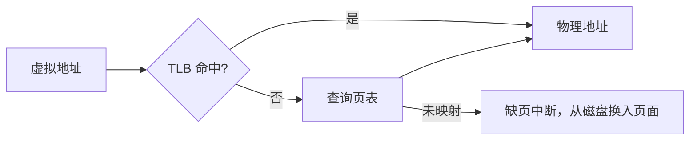

# 操作系统

操作系统管理软硬件资源，为上层应用提供抽象：**进程 → CPU、虚拟内存 → 内存、文件 → 磁盘**。理解操作系统，才能解释后端开发中并发、性能与稳定性问题从何而来。

## 四大模块



本页按"进程 → 内存 → 文件与 I/O"的主线展开，进程调度与 I/O 的交叉点正是后端高并发的核心。

## 用户态与内核态

CPU 分为**用户态**与**内核态**两种特权级：内核态可以执行特权指令、访问全部内存。应用程序通过**系统调用**（syscall）陷入内核态请求服务（读写文件、创建进程、分配内存）；**中断**与异常也是进入内核的入口——外部设备（网卡、磁盘、时钟）用中断通知内核，是异步事件处理的基石。

系统调用有固定开销（态切换 + 上下文保存），这是"批量读写缓冲区""mmap 减少拷贝"等优化存在的原因。

常见系统调用如 `read` / `write` / `fork` / `execve`，`strace` 可以逐条观察进程的系统调用轨迹。

`fork` 的返回值有著名的"两次"现象：父进程中得到子进程 PID，子进程中得到 0——`execve` 随后加载新程序镜像。

## 进程管理

### 进程与线程

| 维度 | 进程 | 线程 |
| ---- | ---- | ---- |
| 地址空间 | 独立 | 共享所在进程 |
| 切换开销 | 大（需切换页表） | 小 |
| 通信方式 | 管道 / 共享内存 / 信号 | 直接读写共享变量 |
| 崩溃影响 | 互不影响 | 一个线程崩溃可能拖垮整个进程 |

线程还有用户级与内核级之分：用户级线程切换快但一个阻塞全部阻塞，内核级线程由内核调度、能利用多核，现代 Linux 采用"一对一"模型。

多进程稳（隔离好）、多线程快（共享省），服务端常见的折中是多进程 + 每进程多线程（或协程）。

进程的典型生命周期：



进程 / 线程切换（**上下文切换**）要保存寄存器、程序计数器等现场，进程还需切换页表，代价高于线程切换——高并发设计的核心目标之一就是减少切换次数。

### 调度与并发

- 常见调度算法：FCFS、SJF、时间片轮转、多级反馈队列；
- 调度的核心权衡：吞吐量、响应时间与公平性，交互式系统更看重响应时间；
- 并发三问题：**竞态条件、死锁、饥饿**；
- 互斥手段：互斥锁、信号量、条件变量。

| 同步原语 | 适用场景 |
| -------- | -------- |
| 互斥锁 mutex | 保护临界区，一次只允许一个线程进入 |
| 信号量 semaphore | 控制同时访问某资源的数量（如缓冲区容量） |
| 条件变量 condition | 等待某个条件成立，必须与互斥锁配合使用 |

死锁的四个必要条件：**互斥、占有且等待、不可剥夺、循环等待**——破坏其中任意一条即可避免死锁，工程上最常用的是"按固定顺序加锁"（破坏循环等待）与"一次性申请全部资源"（破坏占有且等待）。

!!! note "锁的常见坑"

    - 忘记解锁（异常路径）→ 用 RAII / `with` / `defer` 类机制托管；
    - 锁粒度过大 → 并发度下降；粒度过小 → 开销与复杂度上升；
    - 双重检查加锁（如单例）需配合内存屏障，注意指令重排。

经典的生产者-消费者问题，用信号量同时解决互斥与容量限制：

```c
// 生产者-消费者（信号量版本，伪代码）
semaphore mutex = 1, empty = N, full = 0;

producer() {
    while (true) {
        item = produce();
        P(empty); P(mutex);   // 先申请资源信号量，再申请互斥锁，顺序不能反
        insert(item);
        V(mutex); V(full);
    }
}
```

!!! warning "P 操作顺序"

    若先 `P(mutex)` 再 `P(empty)`，缓冲区满时生产者会抱着锁睡眠，消费者却拿不到锁，直接死锁。

## 内存管理

- **虚拟内存**：每个进程拥有独立的虚拟地址空间，通过页表映射到物理内存；
- **页面置换**：LRU、Clock 等算法决定淘汰哪一页；
- **缺页中断**：访问未映射页面时触发，由内核从磁盘调入数据。

常用页面置换算法：

| 算法 | 思路 | 缺点 |
| ---- | ---- | ---- |
| FIFO | 淘汰最早进入的页 | 可能淘汰仍在使用的页 |
| LRU | 淘汰最久未访问的页 | 精确实现硬件开销大 |
| Clock | 循环扫描访问位，LRU 的近似 | 精度与开销折中 |
| LFU | 淘汰访问频率最低的页 | 对历史敏感，易被污染 |

物理内存以固定大小的**页帧**为单位分配，虚拟空间按同样大小的**页**划分，避免外部碎片；分段则按逻辑单元（代码段、数据段）划分，两者可结合使用。

页表项还带权限位（读 / 写 / 执行），支撑写时复制（Copy-on-Write）与 W^X 保护；大页（Huge Page）则减少表项数量与 TLB 未命中。



!!! note "为什么需要虚拟内存"

    隔离（进程互不干扰）、扩容（用磁盘扩展内存）、共享（映射同一物理页）。

## 文件与 I/O

一切皆文件：普通文件、目录、设备、套接字都通过统一的文件描述符（fd）接口访问，内核用 VFS 层屏蔽不同文件系统的差异。

文件元数据存放在 **inode**：权限、大小、时间戳与数据块指针都在其中，文件名只是目录项里指向 inode 的"标签"——硬链接只增加引用计数，不复制数据。

I/O 演进路径：阻塞 I/O → 非阻塞 I/O → I/O 多路复用（`epoll`）→ 异步 I/O。高并发服务器的标配是"多路复用 + 事件回调"：

| 模型 | 特点 |
| ---- | ---- |
| 阻塞 I/O | 一个线程处理一个连接，编程简单但线程开销大 |
| I/O 多路复用 | `select` / `poll` / `epoll`，单线程监听大量 fd |
| 异步 I/O | 内核完成读写后再通知应用，如 Linux 的 `io_uring` |

`select` 用固定大小的位图、每次全量传入并遍历；`poll` 改用链表但仍要遍历；`epoll` 用红黑树管理 fd、就绪事件回调入列，只返回就绪的 fd，连接数大了以后差距明显。

`epoll` 之所以快，在于它用红黑树管理 fd、就绪事件由内核回调加入就绪链表，避免了 `select`/`poll` 每次全量传入与遍历的开销。此外，**零拷贝**（`sendfile`、`mmap`）通过减少"磁盘 → 内核缓冲 → 用户缓冲 → 套接字"之间的数据搬运，大幅提升大文件传输性能。

## 实践要点

1. 排查 CPU 问题先分清内核态与用户态时间占比（`top` 中的 `sy` / `us`），`sy` 高说明系统调用频繁；
2. 多线程共享数据必须加锁，锁的粒度与加锁顺序要有全局约定，从源头避免死锁；
3. 理解虚拟内存后就不难解释：为什么内存用量接近物理上限系统仍能运行（页缓存与换页）；
4. 高并发网络服务优先选择 `epoll` 类事件驱动模型，而非"每连接一个线程"；
5. 文件与网络读写尽量批量缓冲、必要时用零拷贝，减少系统调用与上下文切换次数。
6. 内存与句柄泄漏的根源都在"资源生命周期"：谁分配谁释放，配额与监控要提前设置。
