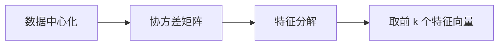

# 线性代数

线性代数研究**向量空间与线性映射**，是理解深度学习数学表达的第一工具：模型的参数是矩阵，输入是向量，前向传播就是一串矩阵乘法。

## 向量与线性组合

- 一组向量**线性无关**，指其中任何一个都不能由其余向量线性组合表示；向量空间的一组**基**是一组线性无关、且能张成全空间的向量；
- 点积衡量两个向量的"对齐程度"：$\boldsymbol{a} \cdot \boldsymbol{b} = \sum_i a_i b_i = \|\boldsymbol{a}\|\, \|\boldsymbol{b}\| \cos\theta$；
- 常用范数：L1 范数 $\|\boldsymbol{a}\|_1 = \sum_i |a_i|$（稀疏正则常用），L2 范数 $\|\boldsymbol{a}\|_2 = \sqrt{\sum_i a_i^2}$（权重衰减的对象）。

余弦相似度只看方向不看长度，是文本向量检索的默认度量：

$$
\cos\theta = \frac{\boldsymbol{a} \cdot \boldsymbol{b}}{\|\boldsymbol{a}\|_2 \, \|\boldsymbol{b}\|_2}
$$

欧氏距离对长度与方向都敏感；高维语义向量的比较通常首选余弦相似度。向量 $\boldsymbol{a}$ 在 $\boldsymbol{b}$ 上的投影是理解 Gram–Schmidt 正交化的基础：

$$
\mathrm{proj}_{\boldsymbol{b}}\, \boldsymbol{a} = \frac{\boldsymbol{a} \cdot \boldsymbol{b}}{\boldsymbol{b} \cdot \boldsymbol{b}}\, \boldsymbol{b}
$$

常见向量运算的几何意义：

| 运算 | 几何意义 |
| ---- | -------- |
| 点积 | 投影长度乘以被投影长度，夹角小于 90° 时为正 |
| 范数 | 向量的"长度" |
| 归一化 | 除以 L2 范数，只保留方向 |

## 矩阵与变换

矩阵 $A \in \mathbb{R}^{m \times n}$ 本质是一个从 $\mathbb{R}^n$ 到 $\mathbb{R}^m$ 的线性映射——满足 $T(\boldsymbol{u}+\boldsymbol{v}) = T(\boldsymbol{u}) + T(\boldsymbol{v})$ 与 $T(c\boldsymbol{v}) = c\,T(\boldsymbol{v})$。神经网络的一层就是一次矩阵乘法加激活：

$$
\boldsymbol{h} = \sigma(A\boldsymbol{x} + \boldsymbol{b})
$$

矩阵乘法满足结合律 $(AB)C = A(BC)$，不满足交换律；$AB$ 的几何意义是"先做 $B$ 的变换，再做 $A$ 的变换"。乘法要求形状匹配：$(m \times n)(n \times k) = m \times k$。

几个特殊矩阵值得牢记：

- 单位矩阵 $I$：乘法下的"1"，$A^{-1}A = I$；
- 对角矩阵：各维度独立缩放；
- 正交矩阵 $Q$（$Q^\top Q = I$）：旋转 / 反射，不改变向量长度与夹角，数值计算中深受偏爱；
- 对称矩阵（$A^\top = A$）：特征值全为实数，协方差矩阵就是它。

转置与求逆的常用性质：$(AB)^\top = B^\top A^\top$，$(AB)^{-1} = B^{-1}A^{-1}$。

同一向量在不同基下坐标不同：取新基对应的变换矩阵为 $P$，则新坐标 $\boldsymbol{x}^{\prime} = P^{-1}\boldsymbol{x}$。特征分解正是寻找一组"最自然"的基——在新基下，变换只是逐方向缩放。

## 核心概念速览

| 概念 | 定义 | 直觉 |
| ---- | ---- | ---- |
| 行列式 | $\det(A)$ | 变换对面积的缩放因子 |
| 秩 | $\mathrm{rank}(A)$ | 变换后空间的维度 |
| 特征值 | $A\boldsymbol{v} = \lambda \boldsymbol{v}$ | 变换下方向不变的向量 |
| 正定性 | $\boldsymbol{x}^\top A \boldsymbol{x} > 0$ | 二次曲面的"碗形"保障 |

方阵可逆当且仅当满秩（$\det(A) \neq 0$）；$\det(A) = 0$ 意味着变换把空间"压扁"，信息不可逆地丢失。对称矩阵正定的判据：所有特征值大于 0，或所有顺序主子式大于 0。

矩阵的迹 $\mathrm{tr}(A)$ 等于特征值之和，行列式等于特征值之积，两者都是相似不变量。

### 核与像

线性映射 $A$ 的**像**（列空间）是所有输出构成的空间，维度即 $\mathrm{rank}(A)$；**核**（零空间）是被映成零向量的输入集合。核越"大"，映射丢失的信息越多——这正是秩亏意味着不可逆的原因。

## 线性方程组

$A\boldsymbol{x} = \boldsymbol{b}$ 有解当且仅当 $\mathrm{rank}(A) = \mathrm{rank}([A \mid \boldsymbol{b}])$；解唯一当且仅当 $A$ 满秩。数值上避免直接求逆，用消元（LU 分解）或迭代法求解。

欠定方程（解不唯一）常加最小范数约束；超定方程（无精确解）退而求最小二乘解。

## 二次型与正定性

二次型 $\boldsymbol{x}^\top A \boldsymbol{x}$ 把矩阵映射为标量；正定性保证它在 $\boldsymbol{x} \neq \boldsymbol{0}$ 时恒为正，几何上是开口向上的"碗"，这也是 Hessian 判极值与牛顿法数值合理的根源。

## 特征值分解与 SVD

$$
A = Q\Lambda Q^{-1}, \qquad A = U\Sigma V^\top
$$

- 特征分解要求方阵，可对角化要求存在 $n$ 个线性无关的特征向量；SVD 对**任意**矩阵成立，是 PCA 的计算核心；
- 奇异值的大小反映对应方向上的"信息量"，截断小奇异值即低秩压缩；
- 对称矩阵可正交对角化：$A = Q\Lambda Q^\top$；
- 数值上求最大特征值常用幂迭代：反复做矩阵-向量乘法，方向收敛到主特征向量，是大规模谱方法（如谱聚类）的标配。

常见矩阵分解对比：

| 分解 | 形式 | 适用范围 | 典型用途 |
| ---- | ---- | -------- | -------- |
| LU | $A = LU$ | 方阵 | 解线性方程组 |
| QR | $A = QR$ | 任意矩阵 | 最小二乘 |
| 特征分解 | $A = Q\Lambda Q^{-1}$ | 可对角化方阵 | 谱分析、动力系统 |
| SVD | $A = U\Sigma V^\top$ | 任意矩阵 | PCA、低秩压缩 |

PCA 的流程用线性代数语言描述：数据中心化 → 计算协方差矩阵 $C = \frac{1}{n}X^\top X$ → 特征分解 → 取前 $k$ 大特征值对应的特征向量作为新坐标系：



## 矩阵微积分一瞥

最小二乘的梯度是一切推导的模板：

$$
\nabla_{\boldsymbol{w}}\, \|X\boldsymbol{w} - \boldsymbol{y}\|^2 = 2X^\top (X\boldsymbol{w} - \boldsymbol{y})
$$

令其为零即得正规方程 $X^\top X \boldsymbol{w} = X^\top \boldsymbol{y}$。

## 常用运算速查

常用函数一览：

```python
import numpy as np

A = np.array([[1., 2.], [3., 4.]])
np.linalg.det(A)     # 行列式
np.linalg.eig(A)     # 特征值/特征向量
np.linalg.qr(A)             # QR 分解
U, S, Vt = np.linalg.svd(A)  # 奇异值分解

# 向量运算
a = np.array([1., 2.])
b = np.array([3., 4.])
a @ b                        # 点积 = 11
np.linalg.norm(a)            # L2 范数
cos = a @ b / (np.linalg.norm(a) * np.linalg.norm(b))  # 余弦相似度

# 解线性方程组 Ax = b（优先于求逆）
b_vec = np.array([1., 2.])
x = np.linalg.solve(A, b_vec)
```

!!! note "几何直觉优先"

    记公式前先想几何：矩阵 = 变换，行列式 = 面积缩放，特征向量 = 变换的"主轴"。

## 实践要点

1. 见到矩阵乘法先核对形状：$(m \times n)(n \times k) = m \times k$，深度学习里多数 shape 错误源于此；
2. 判断一个矩阵能不能"压缩"：看奇异值衰减速度，衰减快即可做低秩近似；
3. 权重衰减惩罚 L2 范数、L1 正则倾向稀疏解，理解范数即理解正则化；
4. 余弦相似度对向量长度不敏感：先归一化再点积，二者等价；
5. 数值上避免直接求逆 $A^{-1}\boldsymbol{b}$，优先用 `np.linalg.solve` 解线性方程组，更稳定。
6. 高维数据的"维度灾难"与秩密切相关：有效信息往往藏在低秩子空间里，降维就是找这个子空间。
