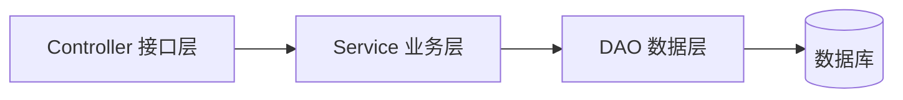

# 后端专栏简介

后端负责**数据、业务与稳定性**。无论语言如何变化，核心命题不变：

- 如何组织业务逻辑（分层架构）；
- 如何存储与检索数据（数据库）；
- 如何应对流量（缓存、异步、水平扩展）。

本专栏聚焦"能落地的工程实践"：框架为什么这么选、代码怎么组织、上线前要检查什么，而非罗列 API 手册。

## 内容导航

- [Python](python.md) —— FastAPI / WSGI 与 ASGI / 并发编程 / 常见部署方式

规划中的主题：数据库设计与索引优化、缓存与消息队列、网关与限流。

## 分层架构

绝大多数后端服务可以抽象为三层，职责从外到内依次收敛：

| 层 | 职责 | 禁忌 |
| ---- | ---- | ---- |
| 接口层 | 协议适配、参数校验、鉴权 | 不写业务逻辑 |
| 业务层 | 编排领域逻辑、界定事务边界 | 不直接拼 SQL |
| 数据层 | 封装 ORM / SQL 访问 | 不感知业务规则 |

!!! abstract "设计原则"

    接口薄、业务厚、数据纯。跨层依赖只允许自上而下，公共逻辑沉淀到独立模块。

## 延伸阅读

- [Git 版本控制](../operation/git.md) —— 多人协作的基础设施；
- [Docker 容器化](../operation/docker.md) —— 后端交付的标准形态；
- [参与贡献](../../contributing/index.md) —— 发现错误或有更好的实践，欢迎反馈。
