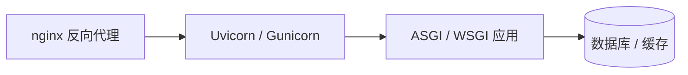

# Python 后端实践

Python 凭借 FastAPI、异步生态成为后端快速开发利器：语法表达力强、生态成熟，从内部脚本到高并发 API 服务都能胜任。本文沿"选型 → 编码 → 依赖管理 → 部署"的主线，给出一条可复制的工程路线。

## Web 框架选型

三大主流框架定位不同，没有绝对优劣，按团队与场景选择：

| 框架 | 定位 | 核心特点 | 适用场景 |
| ---- | ---- | -------- | -------- |
| Django | 全家桶 | 自带 ORM / Admin / Auth，约定大于配置 | 内容型站点、后台管理 |
| Flask | 微框架 | 核心极简，插件自由组合 | 中小项目、快速原型 |
| FastAPI | 现代 API 框架 | 类型注解驱动、自动生成 OpenAPI 文档、原生 async | API 服务、高并发 I/O |

!!! note "选型建议"

    要"开箱即用"选 Django；要灵活轻量选 Flask；主打 API、重视类型检查与文档自动化选 FastAPI。三者可在同一组织共存，不必强行统一。

## WSGI 与 ASGI

Python Web 应用与服务器之间有两代网关协议：

- **WSGI**（PEP 3333）：同步协议，一个请求占用一个工作线程直到响应完成，代表服务器 Gunicorn、uWSGI；
- **ASGI**：异步协议，支持 `async/await`、WebSocket、SSE 等长连接场景，代表服务器 Uvicorn、Hypercorn。



判断标准：用到 `async def` 视图、WebSocket、SSE 就走 ASGI；纯同步的老代码，WSGI 依然稳健。FastAPI 只能运行在 ASGI 服务器上。

## 最小 Web 服务

```python
from fastapi import FastAPI

app = FastAPI()

@app.get("/items/{item_id}")
async def read_item(item_id: int):  # 类型注解同时承担参数校验与文档生成
    return {"item_id": item_id}
```

一行命令启动：`uvicorn main:app --reload`，自动生成交互式文档 `/docs`（OpenAPI Schema 位于 `/openapi.json`）。路径参数声明为 `int` 后，传入非整数会直接返回 422 校验错误。

## 虚拟环境与依赖管理

**每个项目一个独立虚拟环境**是铁律，避免全局污染与版本冲突：

```bash
python -m venv .venv               # 创建虚拟环境
source .venv/bin/activate          # Linux / macOS 激活
.venv\Scripts\Activate.ps1         # Windows（PowerShell）激活
pip install fastapi uvicorn        # 安装依赖
pip freeze > requirements.txt      # 导出依赖清单
```

小项目用 `requirements.txt` 锁定版本即可；追求可复现的团队建议迁移到 `pyproject.toml`，配合 Poetry 或 uv：

| 工具 | 特点 |
| ---- | ---- |
| pip + venv | 标准库自带，最通用 |
| Poetry | 依赖解析 + 锁文件 + 打包发布一体化 |
| uv | Rust 实现，安装与解析极快，兼容 pip 工作流 |

!!! warning "常见坑"

    `pip freeze` 导出的是全量传递依赖，适合"锁定"不适合"声明"。手工维护 `requirements.in` 再编译出锁定文件，或直接用带锁文件的工具更可控。

## 并发模型选型

先记住 GIL（全局解释器锁）这个前提：同一进程内多线程无法并行执行 Python 字节码，但线程在等待 I/O 时会释放锁。

| 场景 | 方案 | 关键库 |
| ---- | ---- | ------ |
| CPU 密集 | 多进程 | `multiprocessing` |
| I/O 密集（同步生态） | 线程池 | `concurrent.futures` |
| I/O 密集（异步生态） | 事件循环 | `asyncio` + `httpx` |

经验法则：

- CPU 密集（图像处理、数值计算）→ 多进程绕开 GIL，或下沉到已释放 GIL 的 C 扩展（如 NumPy）；
- 同步框架下的大量 I/O → 线程池最省心，线程等待 I/O 时释放 GIL；
- 异步框架下 → 全链路使用异步库，混入同步阻塞调用会卡死整个事件循环。

```python
import asyncio
import httpx

async def fetch(client: httpx.AsyncClient, url: str) -> int:
    """请求单个 URL，返回状态码"""
    r = await client.get(url)
    return r.status_code

async def main() -> None:
    urls = ["https://example.com"] * 10
    async with httpx.AsyncClient() as client:
        # gather 并发执行全部协程，一次性收集结果
        codes = await asyncio.gather(*(fetch(client, u) for u in urls))
        print(codes)

asyncio.run(main())
```

## 异步编程要点

异步不是银弹，写错反而更慢，四条底线：

1. **不在协程里调用同步阻塞函数**：`time.sleep`、同步 `requests` 会阻塞事件循环，改用 `asyncio.sleep`、`httpx`；
2. **CPU 密集任务交给执行器**：`asyncio.to_thread` 或 `loop.run_in_executor` 过渡到线程 / 进程池；
3. **并发设上限**：用 `asyncio.Semaphore` 限流，防止瞬间打满下游；
4. **必须设超时**：`asyncio.wait_for(coro(), timeout=3)`，避免协程无限悬挂。

```python
import asyncio

sem = asyncio.Semaphore(10)  # 最大并发 10

async def limited_fetch(client, url):
    async with sem:  # 超出上限的协程在此排队
        return await client.get(url)
```

## 常见部署方式

=== "裸机 + systemd"

    ```bash
    # Gunicorn 管理 Uvicorn worker，多进程承载并发
    gunicorn main:app -w 4 -k uvicorn.workers.UvicornWorker -b 0.0.0.0:8000
    ```

    systemd 托管进程实现开机自启与崩溃拉起，前面挂 nginx 处理静态资源与 TLS 终结。

=== "Docker 容器"

    镜像内只跑 Uvicorn，副本数与端口编排交给 Compose / Kubernetes，环境一致性最好，参见 [Docker 页](../operation/docker.md)。

=== "Serverless 托管"

    FastAPI 可直接部署到云函数或托管平台，注意冷启动耗时与无状态约束（会话外置到 Redis）。

!!! tip "生产配置"

    关闭 `--reload`；worker 数参考 `2 × CPU 核数 + 1`；日志落 stdout 交给容器或 systemd 收集。

## 工程化清单

!!! note "上线前检查"

    - 配置与密钥走环境变量，绝不硬编码；
    - 日志结构化（`structlog` / `logging`），带请求 ID 便于追踪；
    - 数据库连接池 + 迁移脚本（`alembic`）；
    - 健康检查接口 `/healthz`；
    - 类型注解 + `mypy` 静态检查。

在此清单之上，按项目规模补充：接口限流与熔断、灰度发布脚本、性能基线压测报告。

## 实践要点

1. 框架选型看场景不看流行度：Django 管后台、FastAPI 做 API 是常见组合；
2. 全链路异步才能发挥事件循环的威力，一处同步阻塞就让并发优势归零；
3. 依赖必须锁定版本，构建可复现是部署自动化的前提；
4. worker 数量、连接池大小、并发上限都要靠压测确定，不要拍脑袋；
5. 上线前过一遍工程化清单，健康检查与结构化日志是可观测性的底线。
