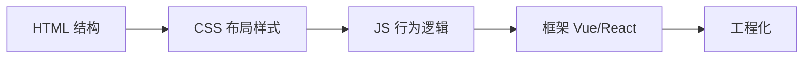

# 前端专栏简介

前端的核心任务：把数据以**可交互**的方式呈现给用户。无论框架如何演进，浏览器最终执行的永远是三件套——它们是前端工程师唯一不会贬值的底层资产。本专栏示例面向现代浏览器（Chrome / Edge / Firefox），不再考虑 IE 兼容。

| 技术 | 职责 | 类比 |
| ---- | ---- | ---- |
| HTML | 结构与语义 | 骨架 |
| CSS | 样式与布局 | 皮肉 |
| JavaScript | 行为与逻辑 | 神经 |

三者交汇于 **DOM**：HTML 解析成 DOM 树，CSS 规则附着在 DOM 上，JavaScript 则随时可以修改两者。

## 内容导航

1. [HTML](html.md) —— 文档结构与语义化标签
2. [CSS](css.md) —— 盒模型、布局体系与响应式
3. [JavaScript](javascript.md) —— 语言核心与浏览器对象

## 学习路线建议

!!! tip "路径"

    原生三件套打牢基础 → 学习一个现代框架（Vue / React）→ 补工程化（打包、类型、测试）。

    不要在基础不稳时直接上框架——框架只是对三件套的封装与抽象。

!!! note "第一件武器：DevTools"

    按 `F12` 打开开发者工具：Elements 看结构、Styles 调样式、Console 跑 JS、Network 看请求。学三件套全程离不开它。

## 如何使用本专栏

- 每篇可独立阅读，建议按 HTML → CSS → JS 顺序通读一遍；
- 示例代码可直接保存为 `.html` 文件双击打开，或粘贴进浏览器控制台验证；
- 遇到陌生的 API，先查 [MDN](https://developer.mozilla.org/zh-CN/)，再回来看本站的归纳；
- 每篇末尾都有「实践要点」，时间紧张时可先读要点，再决定是否通读全文。