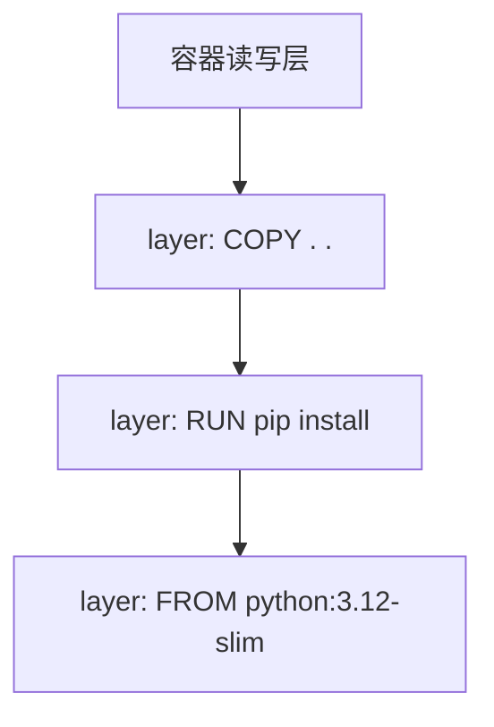

# Docker

Docker 用**容器**把应用与依赖打包成标准化交付物，实现"在我机器上能跑 = 在任何机器上能跑"。相比虚拟机，容器共享宿主内核，秒级启动、开销极小，是 CI/CD 与云原生的事实底座。

## 镜像与容器

- **镜像**（image）：只读模板，分层存储；
- **容器**（container）：镜像的运行实例，读写层叠加在镜像之上。

### 分层原理

每条 Dockerfile 指令生成一层，层可被多个镜像**共享复用**；容器启动时在镜像顶部挂一个读写层，文件修改遵循**写时复制**（Copy-on-Write）：



两个直接推论：

1. **构建缓存**：某层的输入（指令与文件）没变就直接复用缓存，所以依赖安装层要放在源码复制层**之前**；
2. **体积共享**：多个镜像共用同一基础层，磁盘占用远小于各镜像体积之和。

## 常用命令速查

| 场景 | 命令 |
| ---- | ---- |
| 拉取镜像 | `docker pull nginx:latest` |
| 运行容器 | `docker run -d -p 8080:80 --name web nginx` |
| 查看运行中容器 | `docker ps` |
| 进入容器 | `docker exec -it web bash` |
| 查看日志 | `docker logs -f web` |
| 构建镜像 | `docker build -t myapp:1.0 .` |
| 清理无用资源 | `docker system prune` |

`run` 的常用参数：`-v` 挂载数据卷、`-e` 注入环境变量、`--restart=unless-stopped` 崩溃自愈。

## Dockerfile 指令详解

| 指令 | 作用 | 备注 |
| ---- | ---- | ---- |
| `FROM` | 指定基础镜像 | 选 `slim` / `alpine` 减小体积 |
| `WORKDIR` | 设置工作目录 | 后续相对路径的基准 |
| `COPY` | 复制本地文件进镜像 | 优先于 ADD |
| `ADD` | 复制并支持远程 URL / 自动解压 | 语义模糊，仅在需要解压时用 |
| `RUN` | 构建时执行命令 | 相邻命令用 `&&` 合并减少层数 |
| `ENV` | 设置环境变量 | 构建与运行时都生效 |
| `ARG` | 声明构建参数 | 仅构建阶段生效 |
| `EXPOSE` | 声明监听端口 | 仅起文档作用，不做端口映射 |
| `VOLUME` | 声明匿名卷 | 避免数据写进镜像层 |
| `USER` | 切换运行用户 | 生产镜像避免 root |
| `CMD` | 默认启动命令 | 可被 `docker run` 的参数覆盖 |
| `ENTRYPOINT` | 固定入口程序 | 与 CMD 组成"入口 + 默认参数" |

`CMD` 与 `ENTRYPOINT` 的区别：ENTRYPOINT 定义"程序本体"，CMD 提供"默认参数"；`docker run image <args>` 覆盖的是 CMD。

## Dockerfile 最佳实践

```dockerfile
FROM python:3.12-slim

WORKDIR /app

# 先复制依赖文件，利用构建缓存
COPY requirements.txt .
RUN pip install --no-cache-dir -r requirements.txt

COPY . .

EXPOSE 8000
CMD ["uvicorn", "main:app", "--host", "0.0.0.0", "--port", "8000"]
```

!!! tip "要点"

    1. 选 `slim` / `alpine` 基础镜像减小体积；
    2. 变动少的层放前面，充分利用缓存；
    3. 多阶段构建（builder + runtime）进一步瘦身。

再配一个 `.dockerignore`，把无关文件挡在构建上下文之外，传输更快、缓存更稳：

```text
.git
.venv
__pycache__
*.log
node_modules
```

## 多阶段构建

编译环境与运行环境分离：builder 阶段装全套工具链编译产物，runtime 阶段只拷贝产物，最终镜像不携带编译器与缓存：

```dockerfile
# ---- 构建阶段：把依赖装到独立目录 ----
FROM python:3.12-slim AS builder
WORKDIR /app
COPY requirements.txt .
RUN pip install --prefix=/install --no-cache-dir -r requirements.txt

# ---- 运行阶段：只携带运行时必需品 ----
FROM python:3.12-slim
WORKDIR /app
COPY --from=builder /install /usr/local
COPY . .
EXPOSE 8000
USER 1000                      # 不以 root 运行
CMD ["uvicorn", "main:app", "--host", "0.0.0.0", "--port", "8000"]
```

Go、前端等需要重型工具链的项目收益更明显：编译镜像上 GB，运行镜像只有几十 MB。

## 数据卷

容器读写层随容器删除而消失，持久化数据必须放进卷：

| 方式 | 示例 | 特点 | 适用 |
| ---- | ---- | ---- | ---- |
| 命名卷 | `-v pgdata:/var/lib/postgresql/data` | Docker 统一管理，可备份迁移 | 数据库等持久数据 |
| 绑定挂载 | `-v ./src:/app/src` | 直接映射宿主目录 | 开发时热更新代码 |
| tmpfs | `--tmpfs /tmp` | 内存中，容器停止即消失 | 临时敏感数据 |

```bash
docker volume ls                # 卷列表
docker volume inspect pgdata    # 卷详情（宿主路径等）
docker volume rm pgdata         # 删除卷（谨慎）
```

## 网络模式

| 模式 | 说明 | 场景 |
| ---- | ---- | ---- |
| `bridge`（默认） | 接入 docker0 网桥，容器间以容器名互访 | 单机多容器 |
| `host` | 直接使用宿主网络栈，无端口隔离 | 极致网络性能 |
| `none` | 无网络 | 安全隔离任务 |

同一 bridge 网络内的容器可以直接**用容器名当主机名**互访——这正是 Compose 里 `web` 能连 `db` 的原因。

## Docker Compose 编排

```yaml
services:
  web:
    build: .
    ports: ["8000:8000"]
    depends_on: [db]
  db:
    image: postgres:16
    environment:
      POSTGRES_PASSWORD: example
    volumes: ["pgdata:/var/lib/postgresql/data"]

volumes:
  pgdata:
```

生产环境记得把密码挪出 compose 文件，改用 `env_file` 或环境变量注入。

常用命令：

```bash
docker compose up -d          # 一条命令拉起整套环境
docker compose ps             # 服务状态
docker compose logs -f web    # 跟踪某服务日志
docker compose exec web bash  # 进入服务容器
docker compose down           # 停止并移除容器与网络（-v 连卷一起删）
```

## 常用运维命令

```bash
docker stats                  # 实时资源占用（CPU / 内存 / 网络）
docker inspect web            # 容器 / 镜像完整元数据
docker cp web:/app/log.txt ./ # 容器与宿主之间复制文件
docker image ls               # 镜像列表
docker rm -f web              # 强制删除容器
docker rmi myapp:1.0          # 删除镜像
docker system df              # Docker 磁盘占用总览
docker system prune -a        # 清理无用资源（-a 连未使用镜像一起清）
```

!!! warning "清理有风险"

    `prune` 会删除所有已停止容器与悬空镜像，共享机器或生产环境上执行前务必确认范围，不要随手 `-a`。

## 实践要点

1. 依赖层放在源码层之前，把构建缓存的价值最大化；
2. 多阶段构建让运行镜像只含运行时必需品，体积与攻击面一起变小；
3. 持久数据一律上命名卷，绑定挂载留给开发热更；
4. 生产镜像不用 root、不写死密钥，敏感配置运行时注入；
5. 容器视作无状态的：日志落 stdout，会话与文件外置，随时可被替换重建。
