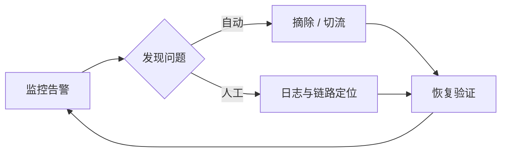

# 运维专栏简介

运维的目标：让服务**稳定、可观测、可恢复**。线上故障不是"会不会发生"，而是"何时发生"——运维体系的价值在于把故障影响面与恢复时间压到可控。

## 内容导航

- :material-source-branch:{ .lg .middle } **Git**

    ---

    版本控制核心概念与常用命令：三层区域、分支策略、reset / revert / reflog 后悔药、stash 与冲突解决。

    [:octicons-arrow-right-24: 开始阅读](git.md)

- :material-docker:{ .lg .middle } **Docker**

    ---

    容器化交付的标准方案：镜像分层、Dockerfile、多阶段构建、数据卷、网络与 Compose 编排。

    [:octicons-arrow-right-24: 开始阅读](docker.md)

## 服务稳定性三板斧

1. **监控**：指标（CPU/QPS/延迟）+ 日志 + 链路追踪；
2. **冗余**：多实例部署，单点故障自动摘除；
3. **演练**：备份恢复、扩容流程平时就要跑通。

三板斧形成的闭环：

!!! abstract "一条经验"

    能自动化恢复的绝不靠人肉响应。每次线上故障之后，都应沉淀为一条监控指标、一个预案或一段自动化脚本，同一个坑不踩第二次。

## 延伸阅读

- [后端专栏](../backend/index.md) —— 了解被运维对象本身的架构；
- [参与贡献](../../contributing/index.md) —— 欢迎补充运维实践与踩坑记录。
