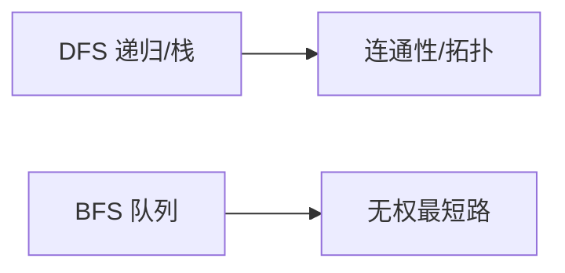

# 图论

图 $G = (V, E)$ 由顶点与边构成，是刻画"关系与连接"的数学结构：地图导航、任务依赖、社交网络、电路布线，本质都是图上的算法问题。本页梳理最常用的图算法族——存储、遍历、最短路、拓扑排序、二分图判定与最小生成树。

## 存储方式

| 方式 | 空间 | 适用场景 |
| ---- | ---- | -------- |
| 邻接矩阵 | $O(V^2)$ | 稠密图、Floyd |
| 邻接表 | $O(V + E)$ | 绝大多数场景（默认选择） |

```cpp
const int N = 1e5 + 5;
vector<pair<int, int>> g[N];  // g[u] 保存 (邻接点, 边权)

void addEdge(int u, int v, int w) {
    g[u].push_back({v, w});
    g[v].push_back({u, w});   // 无向图必须补反向边
}
```

邻接矩阵用 `d[i][j]` 直接存边权，无边记 INF：任意边 $O(1)$ 可查，但对稀疏图浪费空间。

## 图的遍历



```cpp
// BFS：从 s 出发，第一次到达某点的层数即最短跳数
queue<int> q;
q.push(s); vis[s] = true; dist[s] = 0;
while (!q.empty()) {
    int u = q.front(); q.pop();
    for (auto [v, w] : g[u])    // 无权图只用到邻接点 v
        if (!vis[v]) {
            vis[v] = true;          // 入队时立即标记，避免重复入队
            dist[v] = dist[u] + 1;  // 无权图：层数即距离
            q.push(v);
        }
}
```

```cpp
// DFS：递归写法；统计连通块时对每个未访问点各发起一次
void dfs(int u) {
    vis[u] = true;
    for (auto [v, w] : g[u])
        if (!vis[v]) dfs(v);
}

int components = 0;
for (int i = 0; i < n; i++)
    if (!vis[i]) { dfs(i); components++; }  // 发起次数即连通块数
```

DFS 写法简洁，但递归深度达 $10^5$ 级别会爆栈，可改显式栈（见 [代码模板](../templates.md)）。常见用途：连通块计数、判环、割点与桥。

## 最短路算法对比

| 算法 | 适用 | 复杂度 | 备注 |
| ---- | ---- | ------ | ---- |
| BFS | 无权图 | $O(V+E)$ | 层数即距离 |
| Dijkstra | 非负权 | $O(E \log V)$ | 堆优化版最常用 |
| Bellman-Ford | 可负权 | $O(VE)$ | 可检测负环 |
| Floyd | 多源 | $O(V^3)$ | 三重循环，代码最短 |

Dijkstra 的堆优化实现见 [代码模板](../templates.md#dijkstra)。Bellman-Ford 的队列优化版即 SPFA，平均表现好但最坏仍是 $O(VE)$，可被构造数据卡掉；给每个点记入队次数，超过 n 即说明存在**负环**。

Floyd 的核心语义是"只允许前 k 个点作中转"，所以 k 必须放最外层：

```cpp
// d 初始为邻接矩阵：d[i][i] = 0，无边为 INF
for (int k = 0; k < n; k++)      // k 在最外层，逐步放开中转点
    for (int i = 0; i < n; i++)
        for (int j = 0; j < n; j++)
            d[i][j] = min(d[i][j], d[i][k] + d[k][j]);
```

## 拓扑排序

用于 DAG 上的顺序问题（任务调度、依赖编译）：排出的线性序满足所有边"从前指向后"。

```cpp
// Kahn 算法：不断移除入度为 0 的点
queue<int> q;
for (int i = 0; i < n; i++)
    if (!indeg[i]) q.push(i);   // 所有入度为 0 的点先入队

while (!q.empty()) {
    int u = q.front(); q.pop();
    order.push_back(u);
    for (int v : g[u])
        if (--indeg[v] == 0) q.push(v);  // 删边，产生新的零入度点
}
```

若排序后 `order.size() < n`，说明图中**存在环**。拓扑序还是 DAG 上 DP 的合法计算顺序：按序转移即可保证前驱已算完。

```cpp
// 按拓扑序做 DP：求 DAG 上的最长路（dist 初始为 0）
for (int u : order)
    for (auto [v, w] : g[u])
        dist[v] = max(dist[v], dist[u] + w);  // 处理 v 时所有前驱已定型
```

## 二分图判定

二分图指顶点可分成两组、所有边都跨组的图。判定方法：**染色**——相邻点染不同色，图是二分图 ⇔ 不含奇数长度的环。

```cpp
// BFS 染色：color 取 0（未染）/ 1 / -1
vector<int> color(n, 0);
for (int s = 0; s < n; s++) {
    if (color[s]) continue;        // 每个连通块各染一遍
    queue<int> q;
    q.push(s); color[s] = 1;
    while (!q.empty()) {
        int u = q.front(); q.pop();
        for (auto [v, w] : g[u])
            if (!color[v]) { color[v] = -color[u]; q.push(v); }  // 染反色
            else if (color[v] == color[u]) { /* 同色 → 非二分图 */ }
    }
}
```

匈牙利算法求最大匹配的前提就是二分图；工程中的用户—标签、任务—机器分配问题都可建模为二分图匹配。

## 最小生成树

- **Kruskal**：边排序 + 并查集，$O(E \log E)$，稀疏图友好，代码短；
- **Prim**：类似 Dijkstra 的点扩张，稠密图更快（邻接矩阵版 $O(V^2)$）。

```cpp
// Kruskal：边按权从小到大尝试，用并查集跳过会成环的边
sort(edges, edges + m);                // 按 (w, u, v) 排序
int cnt = 0, total = 0;
for (auto& [w, u, v] : edges) {
    if (find(u) == find(v)) continue;  // 两端已连通，选它必成环
    unite(u, v);
    total += w;
    if (++cnt == n - 1) break;         // n 个点的生成树恰有 n-1 条边
}
```

并查集实现见 [代码模板](../templates.md#并查集)。

!!! tip "选型经验"

    单源非负权 → Dijkstra；有负权 → SPFA / Bellman-Ford；多源小图 → Floyd；判环 → 拓扑或并查集。

## 小结

- 存储默认邻接表，无向图记得补反向边；
- BFS 求无权最短路，入队即标记；Dijkstra 遇到负权立即失效；
- 拓扑排序一鱼两吃：定顺序 + 判环；DAG 上的 DP 按拓扑序转移；
- 二分图判定用染色，二分图 ⇔ 无奇环；
- Kruskal 的本质是"贪心选边 + 并查集防环"，选满 n-1 条边即停。