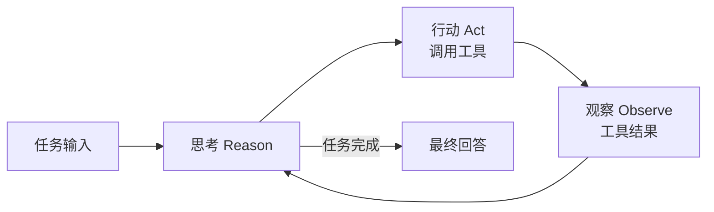
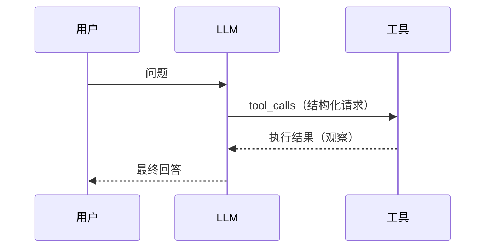

# Agent

Agent = **以 LLM 为大脑，循环执行"感知 → 规划 → 行动"的自主系统**。它不只是问答：能调用工具、维护记忆、根据反馈修正路径，直到完成目标。构成四要素：**LLM（决策）、工具（行动）、记忆（状态）、循环（调度）**。

## Agent 的构成要素

| 要素 | 职责 | 典型实现 |
| ---- | ---- | ---- |
| LLM 大脑 | 理解、决策、反思 | 通用对话 / 推理模型 |
| 工具 | 与外部世界交互 | Function Calling、MCP |
| 记忆 | 保持状态与经验 | 消息历史、向量库、档案 |
| 循环 | 调度感知-行动-观察 | Agent 框架主循环 |

四要素中，LLM 决定上限，工具与上下文工程决定下限——多数 Agent 翻车在后两者。

## 基本循环（ReAct）



核心是让模型交替输出**推理轨迹（Thought）**与**行动（Action）**，用**观察（Observation）**修正后续决策。一次典型的轨迹：

```text
Thought: 用户想知道北京今天的天气，我需要调用天气工具
Action: get_weather
Action Input: {"city": "北京"}
Observation: 晴，12°C，西北风 3 级
Thought: 已拿到天气信息，可以回答了
Final Answer: 北京今天晴，气温 12°C，西北风 3 级，适合户外活动。
```

最简执行循环只需十几行：

```python
def run_agent(llm, tools, task: str, max_steps: int = 10):
    """最简 Agent 循环：模型不再调用工具时视为任务完成。"""
    messages = [{"role": "user", "content": task}]
    for _ in range(max_steps):                       # 步数上限，防死循环
        reply = llm.chat(messages, tools=tools)      # LLM 决策：调工具还是作答
        if not reply.tool_calls:
            return reply.content                     # 无工具调用 = 最终回答
        for call in reply.tool_calls:
            result = execute(call)                   # 应用侧真正执行工具
            messages.append(tool_message(call, result))  # 观察结果回传
    return "已达最大步数，任务未完成。"
```

!!! tip "规划的两个流派"

    - **边走边看（ReAct）**：每步根据观察重新决策，灵活但容易绕路；
    - **先规划后执行（Plan-and-Execute）**：先产出完整计划再逐步执行，可控但怕意外；
    - **反思增强（Reflexion）**：失败后让模型自我复盘，把教训写进记忆再来一轮。

    实践上 ReAct 是底盘：复杂任务先让模型列计划再走步，失败时触发反思。

## 工具调用

```json
{
  "name": "get_weather",
  "description": "查询指定城市实时天气",
  "parameters": {
    "type": "object",
    "properties": {
      "city": {"type": "string", "description": "城市名"}
    },
    "required": ["city"]
  }
}
```



完整闭环五步：**注册工具 Schema → 模型输出 tool_calls → 应用执行 → 结果回传 → 模型继续**。支持并行调用时，模型可一次返回多个独立的工具调用（如同时查天气和日程）。

工具设计的黄金法则：**名称自解释、描述写清适用与边界、参数少而精**。描述里写清"什么时候该用 / 不该用"和返回值格式，比堆工具数量重要得多。

## 记忆机制

| 类型 | 生命周期 | 实现 |
| ---- | -------- | ---- |
| 短期记忆 | 单次会话 | 上下文窗口、消息历史 |
| 长期记忆 | 跨会话 | 向量库检索、结构化档案 |
| 工作记忆 | 当前任务 | 任务状态、TODO 列表 |

工程要点：

- **短期记忆**超窗时滚动摘要：旧轮次压缩成一段摘要，保留关键事实与未决问题；
- **长期记忆**用向量库检索相关历史（"上次我们聊到……"），或维护结构化用户档案（偏好、背景）；
- **工作记忆**常以显式 TODO / 任务清单形式暴露给模型，既是状态也是约束——Coding Agent 的待办列表就是典型。

## 上下文工程

Agent 稳定性的关键是**把正确的信息、在正确的时机、以正确的格式**放进上下文：

- **系统提示**：角色 + 工具使用规范 + 停止条件，一次写清"什么该做、什么绝不做"；
- **历史压缩**：长对话滚动摘要、丢弃冗余轮次，防上下文膨胀导致注意力稀释与成本失控；
- **工具结果裁剪**：超长返回值先截断 / 摘要再入上下文，塞爆窗口只会稀释关键信息；
- **错误注入防护**：工具报错时回传"可恢复的提示"（原因 + 建议下一步）而非裸堆栈——模型看到裸异常常常陷入循环重试；
- **子 Agent 隔离**：海量中间结果（搜索、日志）关在子 Agent 的独立上下文里，只回传结论，主上下文保持干净。

## 多智能体协作

| 模式 | 结构 | 适用 |
| ---- | ---- | ---- |
| 编排者-执行者 | 主 Agent 拆解分发，汇总结果 | 任务可并行拆分 |
| 流水线 | 按职能串行传递 | 写代码 → 审代码 → 测试 |
| 移交（Handoff） | Agent 间按专长转交 | 客服分流、多领域问答 |

通信方式：消息传递（把子 Agent 结果拼回主上下文）或共享黑板（公共状态区，各 Agent 读写）。子 Agent 独立上下文还有**上下文隔离**的收益——把海量中间结果关在子上下文里，只回传结论。

!!! warning "何时不用多智能体"

    单 Agent + 好工具能解决 90% 的问题。多智能体引入的通信开销与失控风险，只有在任务可清晰拆分且并行收益大时才值得。

## 评测与安全

### 评测

- **端到端任务成功率**是金标准：任务是否真正完成，而非看起来有模有样；
- **过程指标**辅助定位：步数、工具调用正确率、无意义循环次数；
- 常用基准：SWE-bench（真实 GitHub issue 修复）、τ-bench（工具调用 + 用户交互）、AgentBench（综合环境）；
- 方法上 LLM-as-judge 打分 + 人工抽检结合，并维护回归集防止迭代退化。

### 安全

- **提示注入**：检索内容、网页、文件里可能藏有恶意指令（间接注入），Agent 的工具越多危害越大；缓解手段：内容隔离标注、工具白名单、输出过滤；
- **最小权限**：工具只授必要权限，高危操作（删库、转账、发邮件）必须 **human-in-the-loop** 人工确认；
- **沙箱执行**：代码 / 命令在容器或隔离环境运行，限制文件系统与网络访问；
- **可观测**：全链路日志（每次思考、调用、观察）落盘，既是调试必需，也是审计凭据。

## 实践要点

1. 单 Agent + 好工具优先，多智能体是最后手段；
2. 工具描述写清"适用边界与返回格式"，收益立竿见影；
3. 每步循环加预算（步数、Token、时间），防失控与成本黑洞；
4. 工具错误信息面向模型优化：说清原因与建议动作，而不是抛裸异常；
5. 高危工具默认人工确认 + 沙箱，宁慢勿险；
6. 评测先行：没有任务成功率基线，所有迭代都是盲调。
