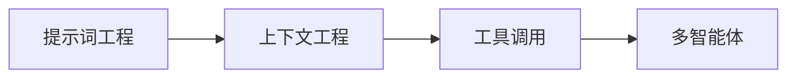

# 模型应用简介

模型应用层把基座能力转化为**产品价值**，核心是两种范式：RAG（外挂知识）与 Agent（自主行动）——前者解决"模型不知道"，后者解决"模型做不到"。

## 内容导航

- :material-book-search:{ .lg .middle } **RAG**

    ---

    检索增强生成，让模型"开卷考试"：切分、混合检索、重排与评估。

    [:octicons-arrow-right-24: 开始阅读](rag.md)

- :material-robot-outline:{ .lg .middle } **Agent**

    ---

    规划、工具调用与多智能体协作：ReAct、记忆与安全。

    [:octicons-arrow-right-24: 开始阅读](agent.md)

## 应用形态谱系

| 形态 | 人机关系 | 典型产品 |
| ---- | -------- | -------- |
| Chatbot | 一问一答 | ChatGPT |
| Copilot | 人主机辅 | GitHub Copilot |
| Agent | 人给目标，AI 执行 | Coding Agent |

## 构建范式

## 两种范式怎么选

| 问题特征 | 优先范式 |
| ---- | ---- |
| 知识过时 / 私有知识缺失 | RAG |
| 需要多步操作外部系统 | Agent |
| 知识与行动交织（边查边做） | Agentic RAG / RAG + Agent 组合 |

!!! note "经验法则"

    能用提示词解决的不要上 RAG；能用单次工具调用解决的不要上多智能体。复杂度每升一级，调试成本翻倍。
