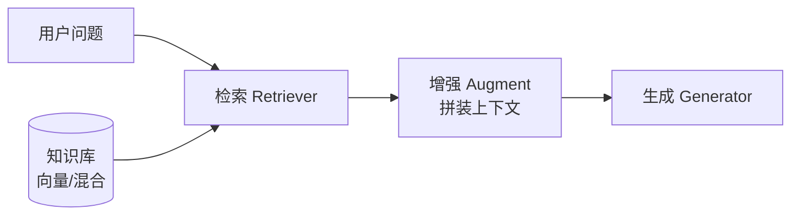

# RAG

RAG（检索增强生成）在生成前先**从外部知识库检索相关内容**注入上下文，解决三类问题：模型知识过时、私有知识缺失、以及无中生有的幻觉。一句话概括：让模型"开卷考试"。

## 基本流程



整条链路分**离线**（建库）与**在线**（检索生成）两段。检索质量决定上限——上下文里没有的信息，模型再强也答不出；生成质量决定下限——检到了答不好，问题出在提示词或模型。多数 RAG 项目效果差，根源在离线的切分与入库，而不是模型本身。

## 离线管线

### Chunking 切分

切分粒度是 RAG 质量的第一决定因素：块太小则上下文不完整，块太大则检索精度被稀释、挤占上下文窗口。

| 策略 | 做法 | 适用 |
| ---- | ---- | ---- |
| 固定长度 | 按 Token 数切，块间留 10%~20% 重叠 | 通用基线 |
| 递归切分 | 按段落 → 句子 → 字符逐级回退 | LangChain 默认 |
| 结构感知 | 按 Markdown 标题、代码函数边界切 | 文档、代码库 |
| 语义切分 | 相邻句向量相似度骤降处断开 | 长文本 |

常用块大小 256~512 Token。进阶做法 **parent-child**：用小块做检索（准），命中后取其父块或整节喂给模型（全）。

### Embedding 编码

Embedding 模型（双塔 / Bi-encoder）把文本映射为向量，语义相近则距离近：

- 中文开源常用 **bge 系列（BAAI）**，通用英文可选 OpenAI text-embedding-3 等；
- 查询与文档通常要分别加**指令前缀**（如 bge 查询侧要求"为这个句子生成表示以用于检索相关文章："）；
- 向量归一化后用余弦相似度（等价于内积）检索。

### 入库与索引

| 向量库 | 定位 |
| ---- | ---- |
| FAISS | 库而非服务，单机实验首选 |
| pgvector | 复用 Postgres，中小规模省事 |
| Milvus / Qdrant | 分布式生产级 |
| Elasticsearch 8+ | 倒排 + 向量，混合检索顺路 |

索引结构常用 **HNSW**（分层图索引，高召回低延迟、内存开销大）或 IVF（聚类倒排，内存友好）。

## 查询理解与改写

用户问题往往不能直接拿去检索，在线侧先做"问题预处理"：

- **指代消解 / 补全**：结合多轮历史把"它多少钱"改写成"iPhone 15 多少钱"；
- **Multi-Query**：让 LLM 把问题改写成多个角度的查询，多路检索后合并；
- **HyDE**：先让 LLM 生成一段"假设性答案"，用假设答案做向量检索——答案与文档的语义距离往往比问题更近；
- **改写有成本**：简单查询直接检索即可，改写与多路扩展留给复杂查询。

## 检索策略

| 策略 | 原理 | 适用 |
| ---- | ---- | ---- |
| 向量检索 | 余弦相似度 | 语义模糊匹配 |
| 关键词检索 | BM25 | 专有名词、编号 |
| 混合检索 | 两者融合 + RRF | 生产默认 |

向量检索擅长语义、不擅长精确符号；BM25 相反。生产环境默认**混合检索**，用 **RRF（倒数排名融合）**合并多路结果：

$$
\mathrm{RRF}(d) = \sum_{r \in R} \frac{1}{k + \mathrm{rank}_r(d)}, \qquad k \approx 60
$$

```python
def rrf_fusion(result_lists, k=60):
    """多路检索结果做 RRF 融合。

    result_lists: 每路检索返回的文档 ID 列表（按相关性降序）
    k: 平滑常数，经验值 60
    """
    scores = {}
    for doc_ids in result_lists:
        for rank, doc_id in enumerate(doc_ids):
            scores[doc_id] = scores.get(doc_id, 0.0) + 1.0 / (k + rank + 1)
    return sorted(scores, key=scores.get, reverse=True)
```

### Reranker 重排

召回阶段追求快（粗召回 Top 50），排序阶段追求准。两种排序模型的结构差异：

| 结构 | 编码方式 | 精度 / 速度 | 用途 |
| ---- | ---- | ---- | ---- |
| Bi-encoder（双塔） | 查询与文档独立编码 | 快，精度有限 | 离线建库、粗召回 |
| Cross-Encoder | 查询与文档拼接后逐对打分 | 精度显著更高，慢 | 小候选集精排 |

典型配置：混合检索召回 Top 50 → Cross-Encoder（如 bge-reranker）精排 → Top 5 注入上下文，精度提升显著、延迟可控。

## 生成侧要点

- 上下文中给每段**引用来源编号**，要求模型作答时标注，降低幻觉并便于核查；
- 重要的内容放在上下文的**开头或结尾**——模型对中间部分注意力偏弱（lost in the middle）；
- 检索为空或分数过低时，指令要求模型明确回答"知识库中未找到"，**不要硬编**；
- 上下文模板结构化：`系统指令 → 引用材料（带编号） → 问题`，让模型清楚哪些是证据、哪些是问题；
- 控制注入块数，宁缺毋滥：无关块会显著拉高幻觉率并挤占窗口。

## 评估体系：RAGAS

!!! abstract "两层评估"

    - **检索层**：Recall@K、MRR（有没有检到对的块）；
    - **生成层**：忠实度（答案是否忠于上下文）、答案相关性。

    分层定位问题：答案错了，先看是"没检到"还是"没答好"。

[RAGAS](https://docs.ragas.io/) 把这套思想标准化为四个自动化指标（用 LLM 代替人工逐项打分）：

| 指标 | 衡量 | 归属 |
| ---- | ---- | ---- |
| Context Precision | 检到的块里相关块排得靠不靠前 | 检索 |
| Context Recall | 必要信息是否都被检到 | 检索 |
| Faithfulness | 答案是否忠于上下文（幻觉程度） | 生成 |
| Answer Relevancy | 答案与问题的相关性 | 生成 |

排障路径：Context 指标低 → 改切分 / embedding / 混合检索；Faithfulness 低 → 改提示词约束、换模型、收紧检索质量。

## 幻觉缓解

1. **证据约束**：提示词明确"仅依据提供的材料作答，材料中没有就说明"；
2. **引用强制**：要求逐句标注来源编号，无来源的陈述不出现；
3. **降低温度 + 拒答出口**：给模型一个体面的"我不知道"，比逼它编造好；
4. **后验校验**：用 NLI 模型或另一个 LLM 核对答案与引用是否一致，不一致则重试或降级；
5. **源头治理**：过时文档定期重建索引——答案的时效性受知识库更新节奏限制。

## 进阶形态

标准"一次检索、一次生成"之外，按问题形态选择进阶结构：

- **Agentic RAG**：把检索包装成工具，让模型自主决定检索时机、查询词与轮数，配合自我反思修正查询；
- **GraphRAG**：离线抽取实体与关系构建知识图谱，擅长全局性、汇总型问题；
- **多模态 RAG**：对图表、截图用多模态 embedding 检索，或先用视觉模型解析为文字再入库。

## 实践要点

1. 先建评测集再调优：几十条标注问答 + RAGAS，胜过凭感觉改参数；
2. 切分策略与文档结构强相关，Markdown / 代码务必结构感知切分；
3. 生产默认混合检索 + Reranker，这条组合拳覆盖大多数场景；
4. 复杂问题（多跳、汇总）用 Agentic RAG：让模型自己决定何时检索、检索什么、检索几轮；
5. 表格与代码是切分重灾区：表格转 Markdown 再嵌入，代码按函数切并保留文件路径上下文；
6. 知识库质量决定上限：文档去重、更新与生命周期管理常被低估。
