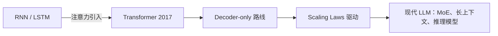

# 模型开发简介

模型开发回答三个问题：**模型长什么样、用什么数据怎么训、如何证明它变好了**。三者分别对应架构设计、训练流水线与评测体系，是理解一切大模型工程决策的地基。

## 内容导航

- [Transformer](transformer.md) —— 架构基石：自注意力、RoPE、GQA/MLA、MoE 与长上下文
- [训练阶段](training-stages.md) —— 完整流程：预训练数据工程 → SFT → RLHF/DPO → 评测

## 关键维度

| 维度 | 核心命题 | 代表概念 |
| ---- | -------- | -------- |
| 架构 | 如何高效建模长序列 | Attention、RoPE、GQA、MoE |
| 数据 | 质量与配比决定上限 | 清洗、去重、课程配比 |
| 训练 | 稳定性与吞吐 | 混合精度、并行策略、loss spike |
| 对齐 | 有用、诚实、无害 | SFT、RLHF、DPO |
| 评测 | 通用能力与安全性 | Benchmark、人类偏好 |

## 技术脉络

!!! tip "认知基线"

    Scaling Laws 是这个领域最底层的经验规律：算力、数据、参数的扩展遵循可预测的损失下降曲线，一切工程决策都在为"更高效的 Scaling"服务——架构改动的意义，往往是让单位算力产出更多有效 Token。

## 阅读收益

读完本节内容，你应当能够：

1. 看懂主流开源模型（Llama、Qwen、DeepSeek）的架构配置与各自改进点；
2. 说清一条 LLM 从预训练到对齐的完整训练流水线，以及每阶段的数据与目标；
3. 面对评测报告，分辨真实提升与刷榜污染；
4. 为后续「模型服务」「模型应用」两节打好概念地基。
