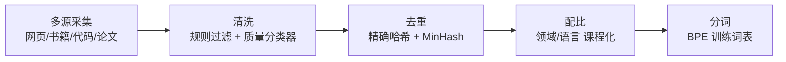
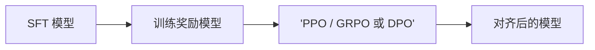

# 训练阶段

现代大模型训练是一条流水线：**预训练 → 监督微调（SFT）→ 基于人类反馈的强化学习（RLHF）**。预训练赋予模型语言与世界知识，SFT 教会它与人交互的格式，RL 系列让行为对齐人类偏好。理解每个阶段的**数据、目标与产出**，是判断模型能力边界的前提。

## 三阶段总览

| 阶段 | 数据 | 目标 | 产出 |
| ---- | ---- | ---- | ---- |
| Pre-training | 万亿级 Token 语料 | 学语言与世界知识 | 基座模型 |
| SFT | 高质量指令数据 | 学会遵循指令 | 对话模型 |
| RL / 偏好优化 | 偏好数据 / 可验证奖励 | 对齐人类偏好 | 对齐模型 |

## 预训练

### 目标函数

在给定上文 $x_{<t}$ 的条件下最大化下一个词元的对数似然：

$$
\mathcal{L}_{\text{PT}}(\theta) = -\frac{1}{T}\sum_{t=1}^{T} \log p_\theta(x_t \mid x_{<t})
$$

### 数据工程：质量决定上限

数据管线：**采集 → 清洗 → 去重 → 配比 → 分词**。



- **清洗**：启发式规则（长度、乱码、广告模板）+ 语言检测 + 轻量质量分类器打分，剔除低质内容；
- **去重**：精确去重（URL/哈希）与模糊去重（MinHash + LSH），重复数据既浪费算力，又加剧记忆、损害泛化；
- **配比**：网页、代码、数学、多语言、书籍按比例混合，代码与数学数据显著提升推理能力；常采用"课程配比"——训练后期上采样高质量数据；
- **分词**：BPE 在语料上训练词表（常见 10 万~25 万量级），词表大小影响压缩率与多语言覆盖。

!!! tip "Scaling Law"

    Chinchilla 定律给出经典参考：在算力预算下，最优训练词元量约为参数量的 20 倍（$D \approx 20N$）。此后"过度训练"小模型（远超 20 倍）成为主流——推理成本远高于训练的一次性投入，更小的模型意味着更便宜的部署。

### 工程核心：稳定性与吞吐

- **loss spike 处理**：训练中偶发损失突刺，常规手段是跳过可疑 batch、回滚到早期检查点重启，并排查脏数据；
- **吞吐优化**：以 MFU（模型算力利用率）为核心指标，混合精度（BF16）训练、张量并行（TP）/流水线并行（PP）/数据并行（DP）组合是标配；
- **学习率调度**：小系数 warmup 后余弦衰减，末期退火通常带来可观的损失下降。

## 监督微调（SFT）

用人工标注的"指令-回答"对继续训练，让基座学会对话格式与指令遵循。要点：

- **数据质量远比数量重要**：LIMA 证明约 1000 条精标数据即可涌现不错的对齐能力，千条精品好过百万条垃圾；
- **配比**：通用对话、代码、数学、多语言、写作、安全拒答等类别均衡采样，覆盖真实用户场景；
- **多轮对话需要正确的 loss mask**：只对回答部分计损，提示词部分置 `ignore_index`；
- **参数效率**：小规模数据常用 **LoRA**（冻结主干、只训低秩增量）或 QLoRA，降低显存与存储成本；大规模数据则全参微调。

```python
import torch.nn.functional as F

def sft_loss(logits, labels):
    """SFT 损失：只对回答部分计损。

    logits: [B, T, V] 模型输出
    labels: [B, T] 提示词部分已置为 -100（HuggingFace 惯例）
    """
    # 位置 t 的 logits 预测第 t+1 个 token，整体错位对齐
    logits = logits[:, :-1, :]
    targets = labels[:, 1:]
    return F.cross_entropy(
        logits.reshape(-1, logits.size(-1)),
        targets.reshape(-1),
        ignore_index=-100,        # 提示词与 padding 位置不计入损失
    )
```

## 强化学习与对齐



### 第一步：训练奖励模型（RM）

对同一提示采样一好一坏两个回答 $(x, y_w, y_l)$，用 **Bradley-Terry** 偏好模型训练打分器：

$$
\mathcal{L}_{\text{RM}} = -\mathbb{E}_{(x,\, y_w,\, y_l)}\left[\log \sigma\big(r_\phi(x, y_w) - r_\phi(x, y_l)\big)\right]
$$

即让奖励模型给好回答的分数显著高于坏回答。

### 第二步：PPO 强化学习

以奖励为信号优化策略，同时用 KL 散度把策略"拴"在参考模型（通常是 SFT 模型）附近，防止模型跑飞或钻空子：

$$
\max_{\pi_\theta}\ \mathbb{E}_{x \sim \mathcal{D},\; y \sim \pi_\theta(\cdot|x)}\big[r_\phi(x, y)\big] - \beta\, \mathrm{KL}\big(\pi_\theta(\cdot|x)\,\big\|\,\pi_{\text{ref}}(\cdot|x)\big)
$$

$\beta$ 是关键超参：太小则模型漂移、奖励黑客泛滥；太大则退回 SFT 行为，学不到偏好。

## DPO：绕开奖励模型

DPO（Direct Preference Optimization）从上述 RLHF 目标的**闭式解**出发：最优策略满足

$$
\pi^*(y|x) \propto \pi_{\text{ref}}(y|x)\exp\!\left(\frac{r(x, y)}{\beta}\right)
$$

反解出奖励并代入 Bradley-Terry 模型，奖励项被策略比值完全替换，偏好对由此变成一个纯监督式的分类损失：

$$
\mathcal{L}_{\text{DPO}} = -\mathbb{E}\left[\log \sigma\!\left(\beta \log \frac{\pi_\theta(y_w|x)}{\pi_{\text{ref}}(y_w|x)} - \beta \log \frac{\pi_\theta(y_l|x)}{\pi_{\text{ref}}(y_l|x)}\right)\right]
$$

| 对比 | RLHF（PPO） | DPO |
| ---- | ---- | ---- |
| 是否需要 RM | 需要，四个模型在线协同 | 不需要，参考模型离线算比值 |
| 数据方式 | 在线采样，可迭代 | 离线偏好对，一次拟合 |
| 稳定性 | 超参敏感、工程复杂 | 简单稳定，易集成进 SFT 管线 |
| 上限 | 在线探索上限更高 | 受离线数据分布约束 |

变体众多（IPO、KTO、SimPO 等），差异主要在损失形式与是否显式参考策略。工程上常见路线：**SFT → DPO 快速对齐，效果或探索性不足时再上 PPO/GRPO**。

## 可验证奖励（RLVR）

数学、代码等有标准答案的场景，可以用**规则自动判分**（答案比对、单元测试通过）替代奖励模型——奖励不再会被"骗"，训练得以大规模在线探索。这正是 o1 / DeepSeek-R1 一类推理模型的核心配方：让模型在长思维链上用 RL 学出"先思考再作答"。

PPO 之外的常用算法 **GRPO**（组相对策略优化）省去价值网络，用同一提示下采样一组的相对优势作为基线，显存与实现成本显著更低，是 RLVR 阶段的主流选择之一。

## 评测体系

| 能力 | 代表 Benchmark |
| ---- | ---- |
| 通用知识 | MMLU / MMLU-Pro |
| 中文能力 | C-Eval、CMMLU |
| 数学推理 | GSM8K、MATH / AIME |
| 代码能力 | HumanEval、LiveCodeBench |
| 指令遵循与偏好 | Arena（人类盲测）、AlpacaEval |

!!! warning "常见坑"

    - **灾难性遗忘**：RL / 后训练阶段原有能力回退，混入 SFT 数据回放缓解；
    - **奖励黑客**：模型钻奖励模型空子（如拉长回答刷分），需 KL 约束并持续对抗更新 RM；
    - **评测漂移**：训练集污染 benchmark 会高估能力，上线前应做去污染筛查，并保留不公开的私有评测集。

## 实践要点

1. **数据 > 算法**：绝大多数收益来自数据质量与配比，而非对齐算法的花样；
2. SFT 优先把 loss mask、对话模板等细节做对，再谈数据规模；
3. 对齐阶段先 DPO 快速拿到基线，效果或探索性不足时再上 PPO/GRPO；
4. RLHF 的 KL 系数 $\beta$ 与奖励模型质量共同决定成败，监控回答长度等侧写指标以尽早发现奖励黑客；
5. 评测集必须去污染，并以人类盲测（Arena 类）作为最终裁判。
