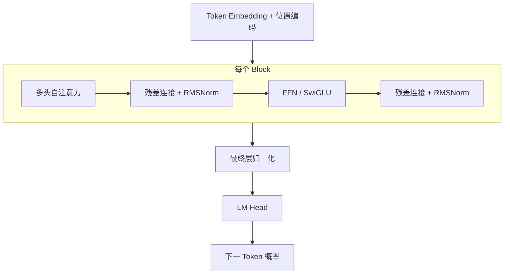

# Transformer

Transformer 以**自注意力**取代循环结构，实现完全并行的序列建模，是大模型的标准架构。当前主流 LLM（GPT、Llama、Qwen、DeepSeek 等）几乎都采用 Decoder-only 形态：堆叠多层带因果掩码的 Transformer Block，自回归地预测下一个 Token。

## 整体结构



理解架构只需要盯住三个部件：**注意力**负责让每个位置收集全序列信息，**FFN** 负责逐位置的非线性变换与知识存储，**残差 + 归一化**负责让几十上百层堆叠仍能稳定训练。

## 自注意力机制

$$
\mathrm{Attention}(Q, K, V) = \mathrm{softmax}\!\left(\frac{QK^\top}{\sqrt{d_k}}\right)V
$$

- $Q, K, V$ 由输入线性变换得到：$Q = XW_Q$、$K = XW_K$、$V = XW_V$；
- $\sqrt{d_k}$ 缩放防止点积过大导致 softmax 饱和；
- 多头机制让不同子空间各自关注不同模式，各头输出拼接后再线性变换；
- 计算与显存开销随序列长度 $T$ 平方增长（$O(T^2)$），这是长上下文优化的核心靶点。

### 最小实现

```python
import torch
import torch.nn.functional as F

def attention(q, k, v, mask=None):
    """标准缩放点积注意力。

    q/k/v 形状: [batch, heads, seq_len, d_k]
    mask: True 的位置被屏蔽（如因果掩码的上三角）
    """
    d_k = q.size(-1)
    scores = q @ k.transpose(-2, -1) / d_k ** 0.5   # 缩放点积
    if mask is not None:
        scores = scores.masked_fill(mask, float("-inf"))
    return F.softmax(scores, dim=-1) @ v            # 加权求和
```

!!! note "因果掩码"

    解码器训练时对上三角位置加 $-\infty$ 掩码，保证每个位置只能看到过去——这是自回归生成的关键。

## 位置编码：RoPE

自注意力本身对位置无感，需要显式注入位置信息。现代 LLM 统一采用**旋转位置编码（RoPE）**：把隐藏维度两两配对，在第 $m$ 个位置旋转一个角度 $m\theta_i$：

$$
\begin{pmatrix} q^{(m)}_{2i} \\ q^{(m)}_{2i+1} \end{pmatrix}
=
\begin{pmatrix} \cos m\theta_i & -\sin m\theta_i \\ \sin m\theta_i & \cos m\theta_i \end{pmatrix}
\begin{pmatrix} q_{2i} \\ q_{2i+1} \end{pmatrix},
\qquad
\theta_i = 10000^{-2i/d}
$$

关键性质：旋转后 $q^{(m)}$ 与 $k^{(n)}$ 的内积**只依赖相对偏移 $m-n$**，天然满足"相对位置"语义；低维对应高频（细粒度近距），高维对应低频（粗粒度远距）。

!!! abstract "长上下文外推"

    训练窗口之外直接使用 RoPE，质量会骤降。常用补救：**位置插值（PI）**直接缩放位置序号；**NTK-Aware** 调大基频 $10000$；**YaRN** 按维度混合插值并修正注意力温度。三者均无需重新预训练即可扩窗。

## 归一化与残差

现代 LLM 用 **RMSNorm** 替代 LayerNorm：去掉均值中心化，只做均方根缩放，计算更省、效果相当：

$$
\mathrm{RMSNorm}(x) = \frac{x}{\sqrt{\frac{1}{d}\sum_{i=1}^{d} x_i^2 + \epsilon}} \odot \boldsymbol{g}
$$

归一化位置统一为 **Pre-Norm**（放在子层之前）：梯度可以经由残差通路无损回传，几十上百层的深层模型也能稳定训练；原始论文的 Post-Norm 在深模型上容易发散。

## 前馈网络：SwiGLU

FFN 占据约三分之二的参数量，通常被视为模型的"知识存储层"。现代 LLM 用门控线性单元 **SwiGLU** 替代普通两层 FFN：

$$
\mathrm{SwiGLU}(x) = \big(\mathrm{SiLU}(x W_1) \odot (x W_3)\big) W_2,
\qquad \mathrm{SiLU}(x) = x \cdot \sigma(x)
$$

其中 $\odot$ 为逐元素相乘。为使参数量与原 $4d$ 结构对齐，中间维度一般取 $\frac{8}{3}d$。

## 注意力变体与 KV Cache

推理时每生成一个 Token 都要读取历史全部 Key/Value，KV 头数直接决定显存占用。演进路线是不断**共享或压缩 K/V 头**：

| 方案 | KV 头数 | 思路 | 代表模型 |
| ---- | ---- | ---- | ---- |
| MHA | = Q 头数 | 原始设计 | Transformer、GPT-2 |
| MQA | 1 | 所有 Q 头共享一组 KV，压缩到极致 | PaLM |
| GQA | 分组共享 | MHA 与 MQA 的折中，质量损失极小 | Llama 2/3、Qwen |
| MLA | 低秩压缩 | KV 联合投影到低秩潜空间后缓存 | DeepSeek-V2/V3 |

GQA 与 MLA 可把 KV Cache 压缩数倍到数十倍，是推理服务显存优化的第一杠杆（详见[推理优化](../serving/inference-optimization.md)）。

## 混合专家 MoE

参数量想继续扩大、又不想让计算量等比上涨，答案是**稀疏激活**：把 FFN 复制为 $N$ 个专家，由路由器为每个 Token 挑选 TopK 个：

$$
y = \sum_{i \in \mathrm{TopK}} g_i(x) \cdot \mathrm{FFN}_i(x),
\qquad
g(x) = \mathrm{softmax}(W_r x)
$$

- 总参数量很大，但**每个 Token 只激活一小部分专家**，算力开销近似于小得多的稠密模型；
- 路由容易"贫富分化"，通常加辅助负载均衡损失 $\mathcal{L}_{\text{aux}} = \alpha N \sum_i f_i P_i$（$f_i$ 为分给专家 $i$ 的 Token 比例，$P_i$ 为平均路由概率）；
- 代表：Mixtral 8×7B（Top-2）、DeepSeek-V3（细粒度专家 + 共享专家，以 bias 调节替代辅助损失）。

## 长上下文工程

把有效上下文从 4K 推到 128K 以上，靠三件事叠加：

1. **高效注意力核**：FlashAttention 以分块计算 + online softmax 避免在显存中生成 $T \times T$ 中间矩阵，数学完全等价，速度与显存大幅改善；
2. **位置编码扩展**：PI / NTK / YaRN 让 RoPE 适配更长窗口；
3. **注意力近似**：滑窗（Mistral）、稀疏注意力等，用局部性换更长序列。

## 训练目标

预训练的目标就是自回归下一词元预测，交叉熵损失：

$$
\mathcal{L}(\theta) = -\frac{1}{T}\sum_{t=1}^{T} \log p_\theta(x_t \mid x_{<t})
$$

训练完成后按概率采样输出（temperature、top-p 等采样策略见[推理优化](../serving/inference-optimization.md)）。

## 关键演进

| 方向 | 代表工作 | 解决的问题 |
| ---- | -------- | ---------- |
| 归一化 | LayerNorm → RMSNorm（Pre-Norm） | 简化计算、训练更稳 |
| 激活 | FFN → SwiGLU | 更好的性能/参数比 |
| 位置编码 | 绝对 → RoPE | 相对位置语义、可外推 |
| 注意力 | MHA → GQA / MLA | 压缩 KV Cache |
| 训练效率 | 标准 Attention → FlashAttention | 免 $T^2$ 中间矩阵、提速 |
| 长上下文 | 直接外推 → PI / NTK / YaRN | 低成本扩窗 |
| 稀疏化 | Dense → MoE | 参数扩展不求激活 |

## 小结

- Decoder-only + 因果掩码 + 自回归预测，是当前 LLM 的标准形态；
- 注意力是引擎，$O(T^2)$ 复杂度与 KV Cache 显存是两大工程靶点，FlashAttention 与 GQA/MLA 分别应对；
- RoPE、RMSNorm（Pre-Norm）、SwiGLU 构成现代开源模型的"标配套餐"；
- MoE 用稀疏激活实现"总参数扩张、单 Token 计算不变"；
- 长上下文 = 高效注意力核 + 位置外推 + 注意力近似，三者叠加而非互斥。
