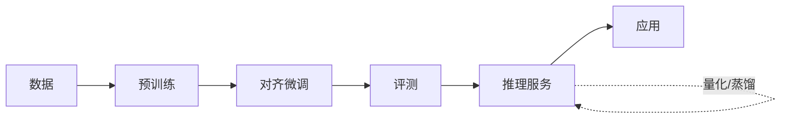

# 大模型专栏简介

本专栏系统梳理大语言模型（LLM）的**开发、服务与应用**全链路：从 Transformer 架构与训练流水线出发，经过在线推理服务的性能优化，最终落到 RAG 与 Agent 的应用构建范式。

## 内容导航

- :material-brain:{ .lg .middle } **模型开发**

    ---

    架构、训练与评测：注意力机制、RoPE、MoE，预训练 → SFT → RLHF 完整流程。

    [:octicons-arrow-right-24: 开始阅读](development/index.md)

- :material-cloud-cog-outline:{ .lg .middle } **模型服务**

    ---

    推理、压缩与部署：KV Cache、PagedAttention、continuous batching、量化与投机解码。

    [:octicons-arrow-right-24: 开始阅读](serving/index.md)

- :material-application-brackets-outline:{ .lg .middle } **模型应用**

    ---

    RAG、Agent 与应用构建范式：检索增强生成、工具调用与多智能体协作。

    [:octicons-arrow-right-24: 开始阅读](application/index.md)

## 全景图

三个板块环环相扣：**开发**决定模型能力的上限，**服务**决定能力交付的效率与成本，**应用**决定能力转化为价值的方式。

!!! note "阅读建议"

    - 有深度学习基础的读者：按 **开发 → 服务 → 应用** 顺序通读，路线最完整；
    - 工程背景读者：可直接跳到 **模型服务** 与 **模型应用**，遇到架构概念再回溯；
    - 各内容页相对独立，也可按需单点查阅。
