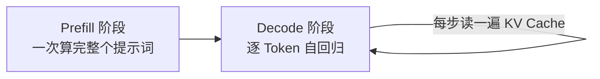
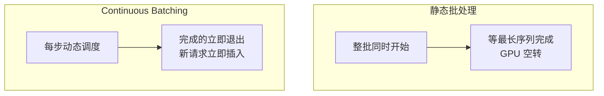

# 推理优化

大模型推理的三大瓶颈：**访存带宽、KV Cache 显存、请求调度**。本页逐一拆解对应的优化技术：从 Prefill/Decode 两阶段的性能特征，到 KV Cache 压缩、PagedAttention、continuous batching、量化与投机解码。

## 性能指标：TTFT 与 TPOT

| 指标 | 定义 | 影响体验 |
| ---- | ---- | ---- |
| TTFT（Time To First Token） | 请求发出到首个 Token 返回 | 用户等多久开始看到字 |
| TPOT（Time Per Output Token） | 首 Token 之后平均每个 Token 的间隔 | 打字机效果的流畅度 |
| Throughput | 单位时间整机完成的 Token 数 | 服务成本 |
| Goodput | 满足 SLO 约束的有效吞吐 | 真实服务质量 |

**TTFT 主要由 Prefill 决定，TPOT 主要由 Decode 决定**，两者的优化手段因此分道扬镳。


## 自回归生成的两阶段



- Prefill 是**计算密集**型：整段提示词并行过一遍网络，是大矩阵乘法，能吃满 GPU 算力；
- Decode 是**访存密集**型：每生成一个词都要完整读一遍权重与 KV Cache，算力大量闲置，瓶颈在显存带宽——这是 Decode 必须靠 batching 摊薄成本的根本原因。

## KV Cache

自回归生成时缓存历史 Key/Value，避免重复计算：

$$
\text{KV 显存} = 2 \times \text{层数} \times \text{头数} \times \frac{d_{head}}{\text{GQA 分组数}} \times \text{序列长} \times \text{批大小} \times \text{字节数}
$$

以 7B 级模型、长上下文、大批并发为例，KV Cache 可达数十 GB，**超过权重本身**。压缩有三条路：

1. **结构压缩**：GQA/MLA 减少 KV 头数（见 [Transformer](../development/transformer.md)）；
2. **数值压缩**：KV Cache 量化到 INT8/FP8；
3. **复用**：Prefix Caching——相同前缀（系统提示、Few-shot、文档）只算一次，跨请求共享；SGLang 的 RadixAttention 用基数树自动管理前缀复用。

## PagedAttention

借鉴操作系统**虚拟内存分页**管理 KV Cache（vLLM 的核心）：

- 将每条请求的 KV 序列切成固定大小的**块（block，如 16 个 Token）**，逻辑连续、物理分散，按需分配；
- 通过块表把逻辑位置映射到物理块，注意力核按块寻址；
- 彻底消除"按最大长度预分配"造成的内部与外部碎片，显存利用率从 ~20% 提升到 90% 以上，等价于更大的有效 batch 与更高吞吐；
- 前缀共享场景下多请求可映射到同一物理块（copy-on-write），与 Prefix Caching 天然契合。

一条请求的逻辑块到物理块的映射示意（逻辑连续、物理分散）：

| 逻辑块 | 物理块 | 状态 |
| ---- | ---- | ---- |
| 0 | 7 | 满 |
| 1 | 3 | 满 |
| 2 | 12 | 半满（尾部按需增长） |

## Continuous Batching

传统静态 batch 必须等最长的序列完成才能换下一批，先完成的请求让 GPU 空转。**连续批处理（iteration-level scheduling）**在**每个 Decode 步的边界**动态插入/移除请求，完成的立即退出、新请求立即插入，吞吐提升数倍到数十倍，是所有现代推理框架的默认行为。



## Chunked Prefill 与 PD 分离

- **Chunked Prefill**：把超长提示词切成若干块，与 Decode 请求交错调度，避免一个长 Prefill 阻塞整批 Decode，改善 TPOT 抖动；
- **PD 分离**：Prefill 计算密集、Decode 访存密集，特征迥异，干脆拆到不同实例部署（如 DistServe、Mooncake 的做法），各自独立扩缩容，SLO 更可控。

## 量化

权重占用是大头（7B 模型 FP16 约 14 GB），量化直接决定"塞得下多少、跑得多快"。

=== "GPTQ"

    基于 Hessian 的**逐列量化 + 误差补偿**：以二阶信息衡量每个权重列的量化误差，量化一列后把误差分摊到未量化列。可做到 INT4，模型质量损失较小。

=== "AWQ"

    **激活感知量化**：少数"显著"权重通道承载了大部分激活能量。AWQ 按激活分布对通道做缩放，$y = (W \operatorname{diag}(s))(\operatorname{diag}(s)^{-1}x)$——缩放前后数学等价，却让显著通道免受量化伤害。INT4 下表现稳健，是当前开源量化部署的主流选择之一。

| 精度 | 相对显存 | 典型质量损失 | 适用 |
| ---- | ---- | ---- | ---- |
| FP16/BF16 | 1× | 基线 | 训练、高精度服务 |
| FP8/INT8 | 0.5× | 几乎无损 | 高吞吐在线服务 |
| INT4（AWQ/GPTQ） | 0.25× | 轻微 | 显存受限、单卡部署 |

!!! note "weight-only 与 weight-activation"

    weight-only（AWQ/GPTQ）只量化权重、激活保持 FP16，省显存但带宽收益打折；weight-activation（FP8/INT8）连激活一起量化，能吃到完整的带宽红利，但对算子支持要求更高。

## 投机采样

用小模型快速起草、大模型一次验证：

1. 草稿模型连续生成 $k$ 个候选词；
2. 目标模型并行验证这 $k$ 个词（一次前向）；
3. 从左到右逐词接受，第 $t$ 个候选被接受的概率为

$$
P_{\text{accept}}(x) = \min\!\left(1, \frac{p(x)}{q(x)}\right)
$$

其中 $p$ 是目标模型、$q$ 是草稿模型的概率；被拒时按修正分布重新采样一个词。

数学上可证明输出分布与目标模型**完全一致**，单步可产出多个 Token。变体方向是"自我草稿"：EAGLE、Medusa 等用目标模型内部特征上的轻量头起草，免去独立小模型。注意：**高并发大 batch 时 GPU 本已饱和，投机解码收益趋近于零**，更适合低并发、低延迟场景。

## 常用推理框架速览

| 框架 | 定位 | 特点 |
| ---- | ---- | ---- |
| vLLM | 通用首选 | PagedAttention 生态成熟 |
| SGLang | 高并发 | RadixAttention 前缀复用 |
| TensorRT-LLM | 极致性能 | NVIDIA 官方深度优化 |
| llama.cpp | 端侧 | CPU / 消费级显卡友好，GGUF 量化 |

```python
from vllm import LLM, SamplingParams

# 用 AWQ 量化模型起步：显存减半、质量基本无损
llm = LLM(
    model="Qwen/Qwen2.5-7B-Instruct-AWQ",
    quantization="awq",
    gpu_memory_utilization=0.9,   # 预留显存比例
)

params = SamplingParams(temperature=0.7, max_tokens=512)
outputs = llm.generate(["用三句话解释 KV Cache 的作用"], params)
print(outputs[0].outputs[0].text)
```

!!! tip "选型建议"

    先用 vLLM 起步建立基线，再针对 TTFT 或吞吐瓶颈引入专项优化。

## 实践要点

1. 先分清瓶颈在 Prefill 还是 Decode：TTFT 差 → 长提示词场景上 Prefix Caching / chunked prefill；TPOT 差 → batching、带宽与量化；
2. 量化是性价比最高的一步：线上 FP8/INT8 起步，显存紧张上 AWQ/GPTQ INT4，务必用业务数据回归评测质量；
3. 系统提示与文档前缀尽量固定，吃满 Prefix Caching 的复用红利；
4. 监控 TTFT/TPOT 的 P99 分位而非平均值，尾延迟才是用户的真实体验；
5. 投机解码只投低并发、低延迟场景，大 batch 下不要指望它。
